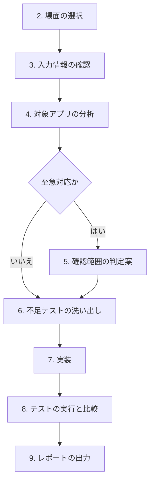

# Patch Regression Test

## 1. 概要と前提

### 1.1 目的

CVE が公開されパッチが提供されたときに、パッチ適用後もアプリの既存の機能が保たれていること（無影響確認）を検証できるようにする。そのために、対象アプリに不足しているテストを洗い出して実装し、結果をレポートにまとめる。平時には、アプリの準備レベルを診断し、不足しているテストを前もって整備する。

### 1.2 ガイドラインの位置づけ

- 作業を始める前に、必ず `references/guideline.md`（以下「ガイドライン」）を読む。このスキルの判断基準は、すべてガイドラインに従う。
- このスキルとガイドラインの記述が食い違う場合は、ガイドラインを優先する。
- 用語（確認範囲・機能テスト・呼び出し箇所・不安定なテスト・暫定合格など）は、ガイドライン 1.5 の定義に従う。
- このリポジトリの中で使う場合は、作業の最初に `references/guideline.md` と正本 `docs/patch-regression-test-guideline.md` を比べる。食い違っていれば、作業を始める前にユーザーに警告する。

### 1.3 このスキルが行うこと

- 対象アプリの分析（言語・アプリの種類・現在のテスト・呼び出し箇所）
- 準備レベルの診断（ガイドライン 3.1.1）
- 確認範囲の判定案の作成（ガイドライン 2 章）
- 不足しているテストの洗い出し（ガイドライン 3〜6 章）
- テストコードの実装と、それを実行するコマンドの提供
- テストの実行。テストを実装したら、追加したテストを実行して正しく動くことを確かめる（単体テスト）。そのうえで、パッチ前後の結果を比べる（コマンドは実行する前に内容を説明する）
- GitHub Actions の workflow の確認と修正。ただし、追加したテストと、全確認範囲共通の最低限（ガイドライン 4.3 の C1〜C6）が workflow で実行されるかを確認し、実行されない場合に実行されるよう必要最小限のステップを加えることだけを行う。workflow 全体の実装は行わない（テストを実行する workflow がまったくない場合に限り、ひな形をもとに最小限の workflow を追加する）
- 無影響確認テスト実施レポートの出力（至急対応は `templates/urgent-template.md`、平時は `templates/readiness-template.md` を使う）

### 1.4 このスキルが行わないこと

| 行わないこと | 担う者 |
|---|---|
| パッチの適用（依存のバージョン更新、確認範囲 2 のコード修正） | Dependabot・Devin などの別のツール |
| 脆弱性情報の収集 | 別のプロセス |
| コミット・プッシュ・PR の作成 | 人や別のツール |
| workflow 全体の実装 | 各チームの CI |
| デプロイ | 各チームの既存の CD |
| 確認範囲の確定、想定どおりの差分の承認 | 開発チームのリーダー |
| 期限の超過、性能の暫定合格の判断 | 次長以上 |
| システムの停止・遮断の判断 | 別途定める意思決定フロー |

### 1.5 成果物

| 成果物 | 置き場所 |
|---|---|
| テストコード | 対象アプリの既存のテストの置き場所に合わせる |
| 呼び出し箇所の一覧 | 対象アプリの `patch-regression-reports/call-sites.md` |
| 対話なしでの実行の設定ファイル | 対象アプリの `patch-regression-reports/auto-settings.md`（2.3） |
| 不安定なテストの一覧 | 対象アプリの `patch-regression-reports/flaky-tests.md`（7.2） |
| 実行コマンドと実行結果 | レポートに記載する |
| workflow の修正 | 対象アプリの `.github/workflows/` |
| 無影響確認テスト実施レポート | 対象アプリの `patch-regression-reports/urgent-<CVE 番号>.md`（平時は `patch-regression-reports/readiness-<日時>.md`） |

### 1.6 作業の流れ

### 1.7 ユーザーの確認を待つ箇所

次の箇所では、案と根拠を示してユーザーに確認を求め、返答があるまで先に進まない。ただし、平時を対話なしで実行する場合（`--auto`）は、2.3 に従う。

確認を求めるときは、判断する人の名前と役割（例: 開発チームのリーダー）もあわせて尋ねる。答えが得られなければ、レポートには「不明」と記録し、推測で書かない。

- 場面の選択、平時の目標の準備レベル（2 章）
- 設定ファイルの保存・更新（2.3）
- 欠けている入力情報の扱い（3 章）
- アプリの種類（4 章）
- 確認範囲の判定案（5 章）
- 外すテストレベル、V9 を対象にするか（6 章）
- 実装する範囲（6 章）
- 新しいライブラリの追加、アプリ本体のコードの修正、テストの仕組みがないときのツールの選択（7 章）
- 不安定なテストの一覧への追加（7 章・8 章）
- workflow の変更・追加（7 章）
- 依存ライブラリのインストール、ネットワークを使う脆弱性スキャン、実行時間の長いテストを手元で実行するか（8 章）
- テストの実行で見つかった差分が想定どおりかどうか、期待値の更新（8 章）
- 既存のレポートの上書き（9 章）

## 2. 場面の選択

### 2.1 場面の受け取り方

起動時の引数で場面を受け取る。

| 場面 | 起動の例 |
|---|---|
| 至急対応 | `/patch-regression-test urgent CVE-2026-12345` |
| 至急対応（複数の CVE をまとめて扱う） | `/patch-regression-test urgent CVE-2026-12345 CVE-2026-23456` |
| 平時 | `/patch-regression-test readiness` |
| 平時（対話なし） | `/patch-regression-test readiness --auto` |

- 引数がない場合は、どちらの場面かをユーザーに質問する。
- 引数がある場合でも、受け取った場面（至急対応なら CVE 番号も）をユーザーに示し、確認を得てから先に進む。ただし `--auto` の場合は 2.3 に従う。
- `--auto` は平時だけで使える。至急対応で `--auto` が指定された場合は、対話での実行に切り替えることをユーザーに伝える。

### 2.2 場面ごとの作業

| 場面 | 通る章 | 8 章で行うこと |
|---|---|---|
| 至急対応 | 3〜9 章のすべて | 追加したテストの単体実行と、パッチ前後の結果の比較 |
| 平時 | 3・4・6・7・8・9 章（5 章の確認範囲の判定は行わない） | 追加したテストの単体実行と、全確認範囲共通の最低限（C1〜C4）の実行 |

- **平時の目標。** どの準備レベルまで整備するか（例: L2 まで）を、ユーザーに選んでもらう。
- **至急対応の時間の見える化。** 3 章で CVE の検知時刻（I12）を確認した直後に、期限（ステージングへのデプロイまで 24 時間、本番反映まで 48 時間、テストの追加と実行の目安 12 時間）を表示する。以降、各章が終わるたびに経過時間をユーザーに報告し、レポートにも記録する。
- **期限を超えそうな場合。** 確認を省略してはならない。期限を超えそうなことと、開発チームのリーダーから次長以上へのエスカレーションが必要であることをユーザーに示し、レポートの「エスカレーションが必要な事項」に記載する（ガイドライン 4.5）。

このスキルが扱うのは、パッチ適用後の無影響確認のためのテストだけである。パッチの適用そのもの（ガイドライン 3.2.2 の計画的な更新を含む）は扱わない。

### 2.3 対話なしでの実行（平時のみ）

ガイドライン 3.2.2 の半年ごとの定期実行では、AI 開発ツールがこのスキルを対話なしで実行する（`--auto`）。

#### 設定ファイル

- 対話なしの実行は、設定ファイル `patch-regression-reports/auto-settings.md` を前提とする。ひな形は `templates/auto-settings-template.md` である。
- **初回の保存。** 平時を対話で実行したときは、最後に、ユーザーが答えた内容を設定ファイルにまとめる。保存する前に内容をユーザーに示し、確認を得てから保存する。すでに設定ファイルがある場合は、変更点を示して更新の確認を得る。
- **設定ファイルがない場合。** `--auto` は使えない。作業を始めずに中止し、「設定ファイルがないため、対話での実行が必要」と伝えて終了する。
- **設定ファイルの形式が正しくない場合。** ひな形どおりの形式になっていない場合（欄が欠けている、選択肢にない値がある など）は、作業を始めずに中止し、その理由を伝えて終了する。
- **設定ファイルは更新しない。** `--auto` では設定ファイルを変更しない。設定を変えるべき点に気づいた場合は、レポートの「要確認」に記載する。

#### 確認箇所の扱い

`--auto` の場合、1.7 の確認箇所では、ユーザーに質問する代わりに次のように扱う。

| 確認箇所 | 対話なしでの扱い |
|---|---|
| 場面の選択（2 章） | 平時として扱う |
| ガイドラインの食い違い（1.2） | 「要確認」に記載し、`references/guideline.md` に従って進める |
| コマンドの説明（10 章） | 説明する相手がいないため、実行したコマンドとその内容をレポートに記録する |
| 目標の準備レベル（2.2） | 設定ファイルの値を使う |
| 設定ファイルの保存・更新（2.3） | 行わない。変えるべき点は「要確認」に記載する |
| 欠けている入力情報（3 章） | 「要確認」に記載して先に進む |
| アプリの種類（4 章） | 設定ファイルの値を使う。コードからの推定と食い違う場合は「要確認」に記載し、設定ファイルの値で進める |
| 外すテストレベル、V9 を対象にするか（6 章） | 設定ファイルの値を使う |
| 実装する範囲（6 章） | 設定ファイルの方針（例: 目標レベルまでの不足をすべて／優先度が高いものだけ）に従う |
| テストの仕組みがないときのツールの選択（7 章） | 設定ファイルに記録されたツールを使う |
| 新しいライブラリの追加（7 章） | 設定ファイルの許可リストにあるものだけ追加する。それ以外は追加せず「要確認」に記載する |
| アプリ本体のコードの修正（7 章） | **行わない**。必要な場合は「要確認」に記載する |
| 不安定なテストの一覧への追加（7 章・8 章） | 行わない。候補は「要確認」に記載する |
| workflow の変更・追加（7 章） | 設定ファイルで許可されている場合に限り行う。許可がなければ行わず、「要確認」に記載する |
| 依存ライブラリのインストール、ネットワークを使う脆弱性スキャン（8 章） | 設定ファイルの許可に従う。許可がなければ行わず、「CI で確認」と記録する |
| 実行時間の長いテスト（8 章） | 設定ファイルの方針に従う。方針がなければ CI に任せる |
| 差分が想定どおりかどうか、期待値の更新（8 章） | 判断しない。期待値も **更新しない**。差分が出た場合は「要確認」に記載する |
| 既存のレポートの上書き（9 章） | 平時のレポートは日時を含む名前で出力するため、上書きは起こらない |

#### 出力

- 平時のレポートの「要確認」の節に、対話で確認するはずだった事項をすべて記載する。担当者は PR のレビューでこれに対応する。
- スキルの手順の中では、コミット・PR の作成は行わない。これらは、スキルの手順が終わった後に、呼び出し元の定期実行の仕組みが行う。

## 3. 入力情報の確認

ガイドライン 7 章の表（I1〜I13）に沿って、作業に必要な情報をそろえる。

### 3.1 確認する項目

| 場面 | 確認する項目 |
|---|---|
| 至急対応 | I1〜I13 のすべて |
| 平時 | I7・I8・I8a・I9・I10 |

### 3.2 情報の集め方

- **リポジトリから自分で集める情報。** 次の情報は、対象アプリのリポジトリを読んで集める。
  - I3: 更新前後のバージョン（比較元ブランチと現在のブランチの lock ファイルなどを比べる）
  - I6: 依存ツリー、一緒に更新される間接依存
  - I7: 言語、アプリの種類、外部との接続先
  - I8・I8a: 現在のテスト、GitHub Actions の workflow、カバレッジのレポート
- **外から渡される情報。** I1・I2・I4・I5（脆弱性情報と変更内容）は、別のプロセスで集められる。
  1. まず、対象アプリのリポジトリの GitHub Issues から、**タイトルに CVE 番号を含む** Issue を探して読む（運用上、脆弱性情報を書く Issue のタイトルには CVE 番号を入れる）。Issue は `gh` コマンドで読む。
  2. 見つからない場合、または `gh` が使えない（未認証など）場合は、ユーザーに会話で渡してもらう。
- **ユーザーに尋ねる情報。** I9（性能ベースライン）・I10（外すテストレベル）・I11（ステージング環境）・I12（検知時刻と期限）・I13（体制）は、リポジトリや Issue で見つからなければユーザーに尋ねる。I13 は参考情報なので、返答がなくても先に進む。

### 3.3 状態の確認

この節は至急対応のときだけ行う。平時は飛ばす。

- **パッチが適用済みであること。** スキルは、パッチを適用したブランチ（例: Dependabot の PR のブランチ）を取得した状態で起動される前提とする。比較元ブランチと現在のブランチの依存関係のファイルを比べ、パッチが適用されていることを確かめる。適用されていなければ、ユーザーに報告して作業を止める。
- **比較元ブランチ。** 8 章で使う比較元ブランチ（リポジトリ変数 `PATCH_BASELINE_BRANCH`、なければマージ先ブランチ）を、ここで確かめておく。リポジトリ変数を読めない場合は、ユーザーに尋ねる。
- **情報の矛盾。** 渡された情報とリポジトリの内容が食い違う場合（例: Issue に書かれた更新後のバージョンと lock ファイルが合わない）は、ユーザーに確認する。

### 3.4 欠けている情報の扱い

ガイドライン 7 章に従う。

1. 欠けている必須の情報を一覧にして、ユーザー（開発チームのリーダー）に示し、追加の判断を求める。返答があるまでこのスキルの作業は先に進めない（ガイドライン 7 章の「対応を止めない」は、脆弱性への対応全体を中止しないという意味であり、このスキルが返答を待つこととは矛盾しない）。
2. 進めてよいと言われた場合は、確認範囲を 1 段上げて作業を進める（5 章）。
3. 欠けている情報と、受けた判断は、レポートに記録する。

### 3.5 記録

集めた情報と、その入手元（リポジトリのファイル名、Issue の番号、会話など）を、9 章のレポートの冒頭に記録する。

## 4. 対象アプリの分析

### 4.1 言語とビルドツール

依存関係のファイルから、言語とビルドツールを判定する。

| ファイル | 言語・ビルドツール |
|---|---|
| `pom.xml`・`build.gradle*` | Java（Maven・Gradle） |
| `pyproject.toml`・`requirements*.txt`・`poetry.lock` | Python |
| `package.json`・`package-lock.json`・`tsconfig.json` | TypeScript |
| `*.csproj`・`*.sln`・`packages.lock.json` | C# |

### 4.2 アプリの種類

起動の入口（Web フレームワーク、main 関数やジョブの定義、画面のフレームワークなど）から、アプリの種類を推定する。推定した種類を選択肢の中から選んだ状態でユーザーに示し、根拠を添えて確認を求める。推定が違う場合は、ユーザーが選び直す。

- 選択肢: バックエンド・バッチ処理・Web フロントエンド・デスクトップアプリ（複数を兼ねる場合は複数選ぶ）

### 4.3 現在のテストと CI の棚卸し

- **テスト。** 使っているテストフレームワーク、テストの種類（単体・結合・E2E・契約・性能）ごとの数と置き場所、テストを実行するコマンドを調べる。
- **CI。** `.github/workflows/` を読み、テストが CI で実行されているか、パッチ前後を比較する workflow（ガイドライン 8.1・9.3）があるかを調べる。
- **不安定なテスト。** ガイドライン 3.4 の不安定なテストの一覧（`patch-regression-reports/flaky-tests.md`）があるかを確かめる。
- **外部との接続先。** DB・API・ファイルなど、外部とのやりとりを洗い出す。契約テストの対象を決めるのに使う。

### 4.4 準備レベルの診断

ガイドライン 3.1.1 の P1〜P11 について、それぞれ「あり」「なし」「理由を記録して外した」のどれにあたるかを判定し、根拠を添えて表にまとめる。そのうえで、アプリの準備レベル（L0〜L3）を判定する。

準備レベルの条件は「CI で動いていること」である。そのため、テストやスキャンがリポジトリにあるだけでは「あり」としない。4.3 で読んだ workflow で実際に実行されていることを確かめてから「あり」とする。リポジトリにはあるが CI で実行されていないものは「なし（CI で未実行）」とする。

### 4.5 呼び出し箇所の一覧

アプリのコードの中で、外部ライブラリを呼んでいる箇所の一覧を作る（ガイドライン 3.1.1 の P4）。

| 場面 | 対象 |
|---|---|
| 至急対応 | 更新するライブラリ（一緒に更新される間接依存を、アプリが直接呼んでいる場合はそれも含む） |
| 平時 | 直接依存しているすべてのライブラリ |

- 呼び出し箇所ごとに、その箇所を通るテストがあるかを調べる。テストコードの中身を読んで判断し、カバレッジのレポートがあれば補助に使う。
- 一覧は `patch-regression-reports/call-sites.md` に保存する。すでにある場合は、内容を現在のコードに合わせて更新する。

### 4.6 記録

4.1〜4.5 の結果を、9 章のレポートに記録する。

## 5. 確認範囲の判定案

至急対応のときだけ行う。確認範囲を確定するのは開発チームのリーダーであり、このスキルは判定案を作るだけである。

### 5.1 判定の手順

ガイドライン 2.2 の流れ図に沿って判定し、分岐ごとに根拠を示す。根拠には、更新前後のバージョン（I3）、リリースノート・変更履歴・移行ガイド（I4）、更新前後のソースの差分（I5）、依存ツリー（I6）を使う。

### 5.2 シグネチャの変更の確認

| 言語 | 確認のしかた |
|---|---|
| Java・C# | パッチを当てた状態でビルドし、コンパイルエラーが出るかで確かめる |
| Python・TypeScript | ガイドライン 2.3 に従い、呼び出し箇所を通る既存のテストを実行して確かめる。型チェック（mypy・tsc など）が設定されていれば、あわせて実行する |

コマンドは実行する前に内容を説明する。ビルドで依存ライブラリのダウンロードが起こる場合は、8 章の冒頭に従ってユーザーの許可を得る。

### 5.3 引き上げ条件の確認

- ガイドライン 4.2 の 3 つの条件（間接依存の変化、CVSS の基本値が 9.0 以上で脆弱な機能を実際に使っている、リリースノートや差分が不十分）を確かめる。「脆弱な機能を実際に使っている」かどうかは、4.5 の呼び出し箇所の一覧と I2 を照らし合わせて判断する。
- 3.4 で、欠けている情報のために確認範囲を上げることになっている場合は、それも 4.2 の条件の 1 つ（影響範囲を特定できない）として数える。
- 当てはまる条件の数にかかわらず、引き上げは 1 段とする。

### 5.4 準備レベルとの照合

- 判定した確認範囲に、4.4 で判定した準備レベルで対応できるかを、ガイドライン 3.1.1 の表で確かめる。対応できない場合は、リーダーから次長以上へのエスカレーションが必要であることをユーザーに示す。
- 確認範囲 3 で、ガイドライン 3.3 の環境確認が CI に組み込まれていない場合は、ガイドライン 4.5 に従い、エスカレーションが必要であることを示す。システムの停止や期限の超過は、このスキルでは判断しない。

### 5.5 確定と記録

判定案と根拠をユーザー（開発チームのリーダー）に示し、確定してもらうまで先に進まない。確定した確認範囲、判定の理由、確定した人を、9 章のレポートに記録する。

## 6. 不足テストの洗い出し

### 6.1 比べる基準

| 場面 | 基準 |
|---|---|
| 至急対応 | ガイドライン 4.3 の C1〜C6、4.4 の確認範囲別の追加テスト、5 章の確認観点 V1〜V11 のうち、5 章で確定した確認範囲にあてはまるもの |
| 平時 | ガイドライン 3.1.1 の P1〜P11 のうち、2.2 でユーザーが選んだ準備レベルまでの項目 |

### 6.2 ユーザーに確認すること

- **外すテストレベル。** 契約テスト・E2E スモークテスト・性能テストのうち、外すものとその理由を確認する（ガイドライン 7 章 I10）。
- **V9（並行処理とリソース）。** シビアな性能が求められるシステムかどうかを確認し、該当する場合だけ対象にする。

### 6.3 不足一覧

4 章の分析結果と 6.1 の基準を比べ、不足しているものを次の形の表にまとめる。

| 項目 | 今の状態 | 足りない内容 | 対応のしかた | 優先度 |
|---|---|---|---|---|
| （例）V4 | 呼び出し箇所 3 か所のうち 1 か所にテストがない | `XmlParser.parse` の呼び出し箇所の機能テスト | テストを追加 | 高 |

- **対応のしかた** は、「テストを追加」「workflow を修正」「チームで対応」のいずれかとする。4.4 で「なし（CI で未実行）」とした項目は、「workflow を修正」とする。
- **チームで対応** には、このスキルでは実装できないものを分類する。例: 性能を測る環境や self-hosted runner の用意、ステージング環境が前提の E2E テスト、インストーラーの作成、ガイドライン 3.3 の環境確認の一部。
- **優先度。** 至急対応では、次の順に優先度を高くする。
  1. 呼び出し箇所を通るテスト
  2. 機能テスト
  3. 脆弱性の修正確認テスト（C5）
  4. そのほか

  平時では、準備レベルの低い項目から順に優先度を高くする（L1 の項目 → L2 の項目 → L3 の項目）。

### 6.4 実装する範囲の選択

優先度の順に並べた不足一覧をユーザーに示し、実装する範囲を選んでもらう。返答があるまで 7 章に進まない。至急対応では、選ばれた範囲がテストの追加と実行の目安（12 時間）に収まりそうかの見込みもあわせて示す。収まりそうにない場合は、そのことをはっきり伝える。

選ばれなかった項目は、理由とともに 9 章のレポートに残存リスクとして記録する。

## 7. 実装

6.4 で選ばれた範囲を実装する。

### 7.1 実装の原則

- **既存のやり方に合わせる。** 今使っているテストフレームワーク、命名のしかた、置き場所、書き方に合わせる。テストの仕組みがまったくない場合は、ガイドライン 9.1 の言語別ツールから候補を選び、ユーザーに確認する。
- **新しいライブラリはユーザーの許可を得てから追加する。** 機能テストのためのライブラリ（例: syrupy・ApprovalTests・Verify）など、まだ入っていないものが必要な場合は、追加するライブラリと理由を示し、許可を得てから追加する。
- **外部には接続しない。** DB・API など外部との接続は、モックやスタブ（本物の代わりに使う偽物）に置き換える。
- **目印を付ける。** 追加したテストには、workflow で選んで実行できるよう目印を付ける（例: pytest のマーカー `patch_regression`、JUnit の `@Tag("patch-regression")`、Jest・Vitest のファイル名の規則、xUnit の `[Trait("Category", "PatchRegression")]`）。
- **アプリ本体のコードは原則として変更しない。** テストを書くためにアプリのコードを直す必要がある場合は、その理由をユーザーに相談する。ユーザーが求めた場合は修正案を示し、ユーザーが許可した場合に限ってアプリのコードを修正する。
- **コミットはしない。** ファイルを変更するところまでで止める。コミット・プッシュ・PR の作成は、人や別のツールに任せる。

### 7.2 テストの種類ごとの実装

| テスト | 実装の内容 |
|---|---|
| 呼び出し箇所を通るテスト | 呼び出し箇所ごとに、その箇所を通る単体テストまたは結合テストを書く |
| 機能テスト | スナップショットや承認テストの仕組みを使い、入出力を記録して比べるテストを書く。記録したファイルはテストコードの近くに置く。パッチ前の入出力の記録は、8 章で比較元ブランチを使って作る。時刻・乱数・ID など実行のたびに変わる値は、ガイドライン 3.4 に従って伏せてから比べる |
| 確認範囲 2 の修正箇所のテスト | アプリ側で修正されたコードについて、変更箇所に絞った単体テストを書く。あわせて、アプリとしてパッチ前と同じ結果を返すことを確かめるテストを書く |
| 脆弱性の修正確認テスト（C5） | Issue の情報から再現する入力を作れる場合だけ書く。攻撃そのものを再現するのではなく、問題になる入力が拒否されることを確かめる形にする |
| 起動スモークテスト（P3） | なければ追加する。ガイドライン 3.1.2 のアプリ種別ごとの入口を使う |
| 不安定なテストの一覧（P11） | 既存のテストを 5 回繰り返して実行し、結果が一定しないテストを候補として示す。一覧（`patch-regression-reports/flaky-tests.md`）に加えるかどうかは、ユーザーに確認する |
| 契約テスト・E2E スモーク・性能テスト | 6.2 で外さないと決めたものだけ書く |

### 7.3 workflow の確認と修正

- 次のものが、対象アプリの GitHub Actions の workflow で実行されるかを確かめる。
  - 追加したテスト
  - 全確認範囲共通の最低限（ガイドライン 4.3 の C1〜C6）。ただし、対象の CVE がない場合（平時）は、C1 の依存ツリーの比較と C5 は対象外とする。C6 は、性能を測る仕組みがない場合は 6.3 の「チームで対応」とする
- 実行されないものがあれば、実行されるように必要最小限のステップだけを加える（例: 目印を付けたテストを実行するステップ、脆弱性スキャンのステップ）。既存のステップの書き換えや、workflow 全体の作り直しはしない。
- **変更の前に承認を得る。** workflow を変更・追加する前に、変更の差分をユーザーに示して承認を得る（`--auto` では、設定ファイルで許可されている場合に限る）。
- テストを実行する workflow が **まったくない** 場合に限り、ガイドライン 9.3 のひな形（`references/guideline.md` から直接読む）をもとに、追加したテストを実行するための最小限の workflow を追加する。workflow 全体の整備は各チームの CI に任せる。

### 7.4 実行コマンドの記録

追加したテストを手元で実行するコマンドを、言語ごとに記録する。8 章で使い、9 章のレポートにも記載する。

## 8. テストの実行と比較

コマンドはすべて、実行する前に内容をユーザーに説明する。依存ライブラリのインストールやビルドなど、外部からのダウンロードを伴うコマンドは、どの作業フォルダで実行する場合も、ダウンロードするものを示してユーザーの許可を得てから実行する。

### 8.1 実行の順番

| 順番 | 内容 | 至急対応 | 平時 |
|---|---|---|---|
| 1 | **追加したテストの単体実行。** パッチを当てた状態（現在のブランチ）で、追加したテストがエラーなく動くかを確かめる。テストのコード自体に誤りがないかの確認である。至急対応では、機能テストはスナップショットなどの期待値を保存しないモード（例: Jest・Vitest の `--ci`）で実行し、この手順で作られた記録は比較の前に捨てる。平時は、この手順で記録した入出力がそのまま機能テストの期待値になる | 行う | 行う |
| 2 | **パッチ前の入出力の記録。** 8.2 の手順でパッチ前の状態を用意し、追加したテストを持ち込んで、機能テストの入出力を記録する | 行う | 行わない |
| 3 | **パッチ後との比較。** 2 で記録したパッチ前の入出力を現在のブランチに持ち込み、パッチを当てた状態の入出力と比べる | 行う | 行わない |
| 4 | **全確認範囲共通の最低限。** ガイドライン 4.3 の C1（ビルドと静的解析、依存ツリーの比較）・C2（起動スモーク）・C3（既存テストの全件実行）・C4（脆弱性スキャン）・C5（修正確認テスト）を実行する | 行う | 行う（C1〜C4。C1 の依存ツリーの比較と C5 は行わない。C4 は特定の CVE を対象にせず、現在の検出結果を記録する） |

- **パッチ前の状態では動かないテスト。** 確認範囲 2 でアプリのコードが修正されている場合など、パッチ前の状態では動かないテストがある。それらは「比較できない」として、理由を記録する。
- **実行時間の長いテスト。** 時間のかかる結合テストやバッチの実行は、手元で実行するか CI に任せるかをユーザーに確認する。CI に任せる場合は、レポートに「CI で確認」と記録する。
- **性能テスト（C6）。** 手元では実行せず、CI に任せる（手元のマシンでは値がぶれやすく、ガイドライン 6.3 の測り方と合わないため）。レポートに「CI で測定」と記録する。
- **CI に任せる確認の受け皿。** CI に任せる確認について、対象アプリの workflow にそれを実行するジョブがない場合は、レポートに「CI 側が未整備のため未確認」と書き、残存リスクと、不足一覧の「チームで対応」に記録する。そのためのジョブ（パッチ前後の比較など）は、このスキルでは追加しない。

### 8.2 パッチ前の状態の用意

- 比較元ブランチ（3.3 で確かめたもの）を、`git worktree` で **別の作業フォルダ** に取り出す。現在の作業フォルダには触れない。
- 作業フォルダは、スキルを実行するたびに新しく作る（フォルダ名に実行日時を `YYYYMMDD-HHmmss` の形式で含める）。作業が終わっても、中断しても、作業フォルダは片付けない。
- パッチ前の状態で依存ライブラリをインストールする必要がある場合（例: `npm ci`・`pip install`）は、この章の冒頭に従ってユーザーの許可を得る。

### 8.3 ネットワークを使う確認

脆弱性スキャン（C4）のツールが外部の脆弱性データベースに問い合わせる場合（例: pip-audit・`npm audit`）は、そのことを示してユーザーの許可を得てから実行する。許可が得られない場合は、レポートに「CI で確認」と記録する。

### 8.4 失敗の切り分け

失敗したテストは、次のどれにあたるかを切り分ける。

| 原因 | 扱い |
|---|---|
| テストのコード自体の誤り | テストを直して、もう一度実行する |
| 不安定なテスト | 一覧（`patch-regression-reports/flaky-tests.md`）にあるテストは、合否の判定に含めない。一覧にないテストは、最大 3 回まで実行し直す。成功と失敗が混ざった場合は「不安定なテストの候補」とし、合否の判定案は「判断待ち」にする。一覧に加えるかどうかは、ユーザーに確認する |
| パッチによる挙動の変化 | 8.5 の差分として扱う |

### 8.5 差分の扱い

- **期待値を勝手に書き換えない。** 差分が出たときに、スナップショットや期待値を黙って更新して合格にしてはならない。更新するには、ユーザーの確認が必要である。
- **パッチ前の記録は更新にあたらない。** 8.1 の手順 2 でパッチ前の状態の入出力を記録することは期待値の作成であり、ここでいう更新にはあたらない。承認が必要なのは、差分が出たときにパッチ後の値で期待値を上書きすることである。
- **差分の分類。** 見つかった差分を、リリースノート・変更履歴（I4）や更新前後の差分（I5）と照らし合わせ、「想定どおりの候補」と「想定外」に分けて示す。
- **ユーザーの判断。** 差分ごとに、想定どおりかどうかをユーザー（開発チームのリーダー）に判断してもらう。返答があるまで先に進まない。想定どおりと承認された差分だけ、期待値を更新してよい。

### 8.6 記録

次の内容を、9 章のレポートのために記録する。

- 実行したコマンドと、その結果
- テストごとの結果の表（パッチ前の結果・パッチ後の結果・差分・判断）
- 比較できなかったテストと、その理由
- CI に任せた確認と、その理由
- 各章の経過時間（至急対応）

## 9. レポートの出力

### 9.1 ひな形と出力先

| 場面 | ひな形 | 出力先 |
|---|---|---|
| 至急対応 | `templates/urgent-template.md` | `patch-regression-reports/urgent-<CVE 番号>.md`（複数の CVE をまとめて扱う場合は `urgent-<CVE 番号>_<CVE 番号>.md`） |
| 平時 | `templates/readiness-template.md` | `patch-regression-reports/readiness-<日時>.md` |

- ひな形の節の構成と順番は変えない。各欄の「書く内容の説明」（`<!-- -->` のコメント）に従って記入し、記入後はコメントを削除する。
- レポートは、至急対応・平時とも PR に含められ、ガイドライン 9.3 の workflow が CI の実行結果を追記して PR のコメントと CI の成果物に残す（ガイドライン 8.3）。そのため、冒頭の「まとめ」は PR のコメントとして読んで意味が通るように書く。
- 該当しない欄は削除せず、「該当なし」と書く。わからないことは「不明」と書き、推測で埋めない。
- 出力先に同じ名前のファイルがすでにある場合は、上書きしてよいかをユーザーに確認する。
- `<日時>` は、レポートを出力する日時を `YYYYMMDD-HHmmss` の形式で書く（例: `readiness-20261114-153045.md`）。Windows でファイル名に使えない `:` は使わない。

### 9.2 合否の書き方

- 合否は、このスキルの **判定案** として書く。最終的な判断は、開発チームのリーダー（性能が不合格の項目は次長以上）が行う。
- 平時の「整備後の準備レベル」は、追加したテストや workflow の修正によって CI で実行される設定になったことをもとにした判定案とする。CI で実際に実行されたことをもって確定する。
- 承認欄（リーダー・次長以上）は空欄のまま出力する。会話の中でユーザーが判断・承認した内容（確認範囲の確定、差分の承認など）は、判断した人と日時を添えて該当する欄に記録する。

### 9.3 出力の前の確認

レポートを書き終えたら、次を確かめてからユーザーに出力先を伝える。

- 1.7 の確認箇所で受けた判断が、すべて記録されている
- 選ばれなかった項目、外したテスト、CI に任せた確認、比較できなかったテスト、欠けていた情報が、すべて残存リスクに記載されている
- エスカレーションが必要な事項（準備レベル不足、確認範囲 3、性能の不合格）が漏れなく記載されている
- パスワード・トークンなどの秘密情報が含まれていない

### 9.4 中断したとき

ユーザーが中止を求めた場合や、エラーで先に進めなくなった場合は、次のようにする。

- それまでの結果をレポートに記録し、まとめの判定案を「中断」とする。中断した章と理由も記録する。
- 追加・変更したファイルの一覧をユーザーに示す。
- 8.2 の作業フォルダは片付けない（8.2）。

## 10. 制約

- **実行環境のルールを優先する。** 実行環境のルール（CLAUDE.md など）とこのスキルの記述が食い違う場合は、実行環境のルールに従う。`gh` など外部のサービスを使うコマンドも、実行環境のルールに従う。
- **コマンドは実行前に説明する。** コマンドを実行する前に、必ずその内容をユーザーに説明する（対話なしでの実行では、実行したコマンドとその内容をレポートに記録する）。
- **行わないことは行わない。** 1.4 の「行わないこと」は、ユーザーに頼まれても行わず、担う者を案内する。
- **確認を待つ。** 1.7 の箇所では、必ずユーザーの返答を待ってから先に進む（対話なしでの実行は 2.3 に従う）。
- **期待値を勝手に書き換えない。** 期待値やスナップショットは、ユーザーの承認なしに更新しない（8.5）。
- **外部に接続しない。** テストの中で本物の外部サービス（DB・API など）に接続しない。ネットワークを使う作業（依存ライブラリのインストール、脆弱性データベースへの問い合わせ）は、ユーザーの許可を得てから行う。
- **秘密情報を書かない。** パスワード・トークン・接続文字列などの秘密情報を、テストコードやレポートに書かない。
- **攻撃コードを作らない。** 脆弱性の修正確認テスト（C5）は、問題になる入力が拒否されることの確認にとどめ、攻撃をそのまま再現するコードは作らない。
- **推測で埋めない。** わからないことは「不明」として扱い、推測で判断や記録をしない。
