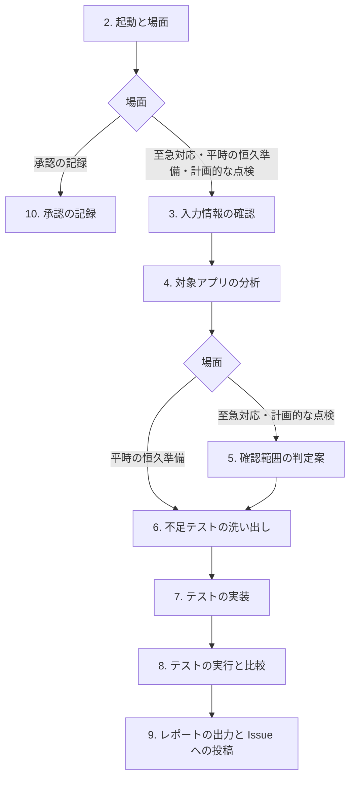

# 無影響確認テスト（patch-regression-test）

## 1. 概要と前提

### 1.1 目的

パッチや修正を適用した後も、アプリの既存の機能が保たれていること（無影響確認）を確かめる。そのために、対象アプリに不足しているテストを洗い出して実装し、パッチ前後の結果を比べ、結果をレポートにまとめて Issue に投稿する。

このスキルは、ガイドラインの次の 3 つの場面で使う。

- **至急対応。** 別のプロセスから至急対応を求められた CVE のパッチの無影響確認を、期限内に行う。
- **平時の恒久準備。** アプリの準備レベルを診断し、不足しているテストを前もって整える（初回も 2 回目以降も同じ）。
- **計画的な点検。** 初回の平時の恒久準備の後、外部のツールや人が行った修正（依存の更新・脆弱性の修正・ソースコードの修正）について、無影響確認を行う。

### 1.2 ガイドラインと技術基準

- 作業を始める前に、必ず次の 2 つを読む。
  - `references/guideline.md`（以下「ガイドライン」）：何を満たすべきか（分類、合否の条件、役割、判定のルール）
  - `references/standards.md`（以下「技術基準」）：どうやって満たすか（ツール、確かめ方、測り方、ファイル名）
- 判断の基準はガイドラインに従い、やり方は技術基準に従う。このスキル・技術基準・ガイドラインの記述が食い違う場合は、ガイドラインを優先する。
- 用語（確認範囲・平時の恒久準備・計画的な点検・機能テスト・呼び出し箇所・不安定なテスト・暫定合格など）は、ガイドライン「1.5：用語」の定義に従う。
- 展開先のリポジトリでは、このスキルを `.github/skills/patch-regression-test/` に置く（GitHub Copilot と Devin の両方が読む場所）。

### 1.3 このスキルが行うこと

- 対象アプリの分析（言語・アプリの種類・現在のテストと CI・呼び出し箇所）
- 準備レベルの診断（ガイドライン「3.1.1：準備レベル」）
- 確認範囲の判定案の作成（ガイドライン「2章：パッチの分類と確認の基準」）
- 不足しているテストの洗い出し
- テストコードの実装。テストを動かすためのライブラリの導入は、ユーザーの許可を得て行う
- テストの実行と、パッチ前後の結果の比較（コマンドは実行する前に内容を説明する）
- 無影響確認テスト実施レポートの出力と、Issue へのコメントの投稿（PR がある場合は、PR にも Issue へのリンクをコメントする）
- きっかけの Issue がない場合の Issue の作成（許可を得て行う）
- リーダーの承認の記録（PR の承認と照合し、Issue のコメントとして残す）

### 1.4 このスキルが行わないこと

次のことは、ユーザーに頼まれても、許可があっても行わない。担う者を案内する。

| 行わないこと | 担う者 |
|---|---|
| パッチの適用、アプリのソースコードの修正（依存のバージョン更新、破壊的変更への対応、脆弱性の修正、静的コード解析の指摘への対応、テストを書くための修正を含む） | Dependabot・Devin などの別のツール、または人 |
| アプリを動かすための環境設定（実行環境・ミドルウェアのインストールや設定の変更）。テストを動かすためのライブラリの導入は除く | 人、または各チームの CI |
| workflow の変更・追加 | 各チーム（別に定めるガイドラインに従う） |
| コミット・プッシュ | スキルを呼び出したツール、または人 |
| 脆弱性情報の収集、至急対応の要否の判断、静的コード解析の実施 | 別のプロセス |
| デプロイ | 各チームの既存の CD |
| 確認範囲の確定、想定どおりの差分の承認、PR の承認 | 開発チームのリーダー |
| 性能が不合格のときのリリースの判断、期限の超過の判断 | 次長以上 |
| システムの停止・遮断の判断 | 別途定める意思決定フロー |

### 1.5 成果物

| 成果物 | 置き場所 |
|---|---|
| テストコード | 対象アプリの既存のテストの置き場所に合わせる |
| 呼び出し箇所の一覧 | 対象アプリの `patch-regression-reports/call-sites.md` |
| 不安定なテストの一覧 | 対象アプリの `patch-regression-reports/flaky-tests.md` |
| 対話なしでの実行の設定ファイル | 対象アプリの `patch-regression-reports/auto-settings.md` |
| 無影響確認テスト実施レポート | 対象アプリのテスト資源を置くディレクトリの下の `patch-regression-reports/` の中（名前は技術基準に従う） |
| レポートのコメント | きっかけの Issue。関係する Issue が複数ある場合はすべて（「9.4：Issue と PR へのコメントの投稿」） |
| レポートへのリンクのコメント | 対象の PR（PR がある場合） |
| 承認の記録のコメント | きっかけの Issue（「10章：承認の記録」） |

ファイルはリポジトリの中に保存するところまでとし、コミットはスキルを呼び出したツールや人に任せる。

### 1.6 作業の流れ

### 1.7 ユーザーの確認を待つ箇所

次の箇所では、案と根拠を示してユーザーに確認を求め、返答があるまで先に進まない。対話なしでの実行（`--auto`）の場合は、「2.3：対話なしでの実行（計画的な点検のみ）」に従う。

確認を求めるときは、判断する人の名前と役割（例: 開発チームのリーダー）もあわせて尋ねる。

- 場面と対象（CVE 番号・PR）の確認、平時の恒久準備の目標の準備レベル（「2章：起動と場面」）
- 設定ファイルの保存・更新（「2.3：対話なしでの実行（計画的な点検のみ）」）
- 情報の矛盾、欠けている入力情報の扱い（「3.3：状態の確認」・「3.4：欠けている情報の扱い」）
- アプリの種類（「4.2：アプリの種類」）
- 確認範囲の判定案、確認範囲 3 で対象にする項目、破壊的変更の一覧、テストの対象にする修正箇所（「5章：確認範囲の判定案」）
- 外すテストレベル、V9：並行処理とリソース を対象にするか（「6.2：ユーザーに確認すること」）
- 実装する範囲（「6.4：実装する範囲の選択」）
- テストを動かすためのライブラリの追加、テストの仕組みがないときのツールの選択（「7.1：実装の原則」）
- 不安定なテストの一覧への追加（「7.2：テストの種類ごとの実装」・「8.4：失敗の切り分け」）
- テストを動かすためのライブラリのインストール、ネットワークを使う脆弱性スキャン・静的コード解析、実行時間の長いテストを手元で実行するか（「8章：テストの実行と比較」）
- テストの実行で見つかった差分が想定どおりかどうか、期待値の更新（「8.5：差分の扱い」）
- Issue の作成、Issue と PR へのコメントの投稿（「9.4：Issue と PR へのコメントの投稿」）

## 2. 起動と場面

### 2.1 起動のしかた

起動時の引数で場面を受け取る。

| 場面 | 引数の例 |
|---|---|
| 至急対応 | `urgent CVE-2026-12345`（複数の CVE をまとめて扱う場合は `urgent CVE-2026-12345 CVE-2026-23456`） |
| 平時の恒久準備 | `readiness` |
| 計画的な点検 | `planned 123`（`123` は修正の PR の番号。省略できる） |
| 計画的な点検を対話なしで実行 | `planned 123 --auto` |
| 承認の記録 | `approve 123`（`123` は PR の番号） |

- **対象の PR。** 至急対応・計画的な点検・承認の記録では、パッチや修正を含む PR が、スキルを起動する前に作られていることを前提とする（Dependabot・Devin・人が作る）。
- **対象の Issue（投稿先）。** レポートを投稿する Issue を、場面に応じて次のように特定する。関係する Issue が複数ある場合は、すべてを対象にする。
  - 至急対応：タイトルに対象の CVE 番号を含む Issue（ガイドライン「7.1：脆弱性情報とパッチの変更内容の置き場所」）
  - 計画的な点検：PR にリンクされた Issue。なければ、タイトルの決まり（「定期の乖離チェック」「静的コード解析」）で探す。見つからなければ作る
  - 平時の恒久準備：Issue はないので作る
  - 承認の記録：PR にリンクされた Issue
- 引数がない場合は、どの場面かをユーザーに質問する。
- 引数がある場合でも、受け取った場面と対象（CVE 番号・PR・投稿先の Issue）をユーザーに示し、確認を得てから先に進む。`--auto` の場合は「2.3：対話なしでの実行（計画的な点検のみ）」に従う。
- **計画的な点検の PR。** PR 番号が省略された場合は、現在のブランチに対応する PR を `gh` で特定し、ユーザーに示して確認を得る。
- **`--auto` は、計画的な点検（`planned`）に限って使える。** ほかの場面で `--auto` が指定された場合は、使えないことを伝え、対話での実行に切り替える。

### 2.2 場面ごとの作業

| 場面 | 通る章 | 「8章：テストの実行と比較」で行うこと |
|---|---|---|
| 至急対応 | 3〜9 章 | 追加したテストの単体実行、パッチ前後の比較、ガイドライン「2.4：全確認範囲で共通のテスト」の実行 |
| 平時の恒久準備 | 3・4・6〜9 章（5 章は行わない） | 追加したテストの単体実行、ガイドライン「2.4：全確認範囲で共通のテスト」のうち C1〜C4 の実行（比べる相手と対象の脆弱性がないため、C1 の依存ツリーの比較と C5・C7 は行わない） |
| 計画的な点検 | 3〜9 章 | 追加したテストの単体実行、修正前後の比較、ガイドライン「2.4：全確認範囲で共通のテスト」の実行 |
| 承認の記録 | 10 章のみ | 行わない |

- **「パッチ」の読み替え。** 計画的な点検では、このスキル全体で「パッチ」を「修正」と読み替える（例: 「パッチ前」は「修正前」）。
- **平時の恒久準備の目標。** どの準備レベルまで整えるか（例: L2 まで）を、ユーザーに選んでもらう。
- **至急対応の時間の見える化。** 「3章：入力情報の確認」で至急対応の着手の依頼時刻（I12）を確認した直後に、期限（ステージングへのデプロイまで 24 時間、本番反映まで 48 時間、テストの追加と実行の目安 12 時間）を表示する。以降、各章が終わるたびに経過時間をユーザーに報告し、レポートにも記録する。
- **期限を超えそうな場合（至急対応）。** 確認を省略してはならない。期限を超えそうなことと、開発チームのリーダーから次長以上へのエスカレーションが必要であることをユーザーに示し、レポートの「エスカレーションが必要な事項」に記載する。
- **平時には期限がない。** 平時の恒久準備と計画的な点検では、期限の表示と経過時間の報告は行わない。暫定合格も使わない。

### 2.3 対話なしでの実行（計画的な点検のみ）

計画的な点検では、AI 開発ツールが、修正の PR に対してこのスキルを対話なしで実行してよい（`planned <PR 番号> --auto`）。点検の種類（依存の更新・脆弱性の修正・ソースコードの修正）は問わない。

対話で実行していれば人に確認して決めていた事項は、レポートの「対話なしでの実行時に見つかった要確認項目」の節（以下、この節では「要確認」）に記載する。担当者は、PR のレビューの際に、Issue に投稿されたレポートの「要確認」に対応する。

#### 2.3.1 設定ファイル

- 対話なしでの実行は、設定ファイル `patch-regression-reports/auto-settings.md` を前提とする。ひな形は `templates/auto-settings-template.md` である。
- **PR が設定ファイルを変更している場合は中止する。** PR の変更ファイルの一覧（例: `git diff --name-only <比較元ブランチ>...HEAD`）に設定ファイルが含まれる場合は、作業を始めずに中止し、対話での実行が必要であることを伝えて終了する。PR 自身が許可の範囲を変えられないようにするためである。
- **保存。** 平時の恒久準備または計画的な点検を対話で実行したときは、最後に、ユーザーが答えた内容を設定ファイルにまとめる。保存する前に内容をユーザーに示し、確認を得てから保存する。その場で尋ねていない項目は、推測で書かずにユーザーに尋ねる。すでに設定ファイルがある場合は、変更点を示して更新の確認を得る。
- **設定ファイルがない場合、または形式が正しくない場合。** `--auto` は使えない。作業を始めずに中止し、理由を伝えて終了する。
- **`--auto` では設定ファイルを更新しない。** 設定を変えるべき点に気づいた場合は、「要確認」に記載する。

#### 2.3.2 確認箇所の扱い

`--auto` の場合、「1.7：ユーザーの確認を待つ箇所」では、ユーザーに質問する代わりに次のように扱う。

| 確認箇所 | 対話なしでの扱い |
|---|---|
| 場面と対象の PR | 計画的な点検として扱う。PR は引数の番号を使う。番号がなければ中止する |
| 設定ファイルの保存・更新 | 行わない。変えるべき点は「要確認」に記載する |
| コマンドの説明 | 説明する相手がいないため、実行したコマンドとその内容をレポートに記録する |
| 情報の矛盾 | 「要確認」に記載し、リポジトリの内容をもとに進める |
| 欠けている入力情報 | 残存リスクとして記録する |
| アプリの種類 | 設定ファイルの値を使う。ソースコードからの推定と食い違う場合は「要確認」に記載し、設定ファイルの値で進める |
| 確認範囲の判定案、確認範囲 3 で対象にする項目、破壊的変更の一覧、テストの対象にする修正箇所 | 判定案と一覧で進める。確定は「要確認」に記載し、リーダーが PR のレビューで行う |
| 外すテストレベル、V9：並行処理とリソース を対象にするか | 設定ファイルの値を使う |
| 実装する範囲 | 設定ファイルの方針に従う |
| テストの仕組みがないときのツールの選択 | 設定ファイルに記録されたツールを使う |
| テストを動かすためのライブラリの追加 | 設定ファイルの許可リストにあるものだけ追加する。それ以外は追加せず「要確認」に記載する |
| 不安定なテストの一覧への追加 | 行わない。候補は「要確認」に記載する |
| ライブラリのインストール、ネットワークを使う脆弱性スキャン・静的コード解析 | 設定ファイルの許可に従う。許可がなければ行わず、「CI で確認」と記録する |
| 実行時間の長いテスト | 設定ファイルの方針に従う。方針がなければ CI に任せる |
| 差分が想定どおりかどうか、期待値の更新 | 判断しない。期待値も **更新しない**。差分が出た場合は「要確認」に記載する |
| Issue と PR へのコメントの投稿 | 行う。投稿の前の確認は省く |
| きっかけの Issue がない場合の Issue の作成 | 作る。作る前の確認は省く |

## 3. 入力情報の確認

ガイドライン「7章：着手前に収集する情報」の表（I1〜I14）に沿って、作業に必要な情報をそろえる。

### 3.1 確認する項目

| 場面 | 確認する項目 |
|---|---|
| 至急対応 | I1〜I13 のすべて。ソースコードの修正を含む場合は I5 に修正の PR の差分を含める |
| 平時の恒久準備 | I7・I8・I8a・I9・I10・I13 |
| 計画的な点検 | 点検の種類に応じて、ガイドライン「7章：着手前に収集する情報」の「計画的な点検で使う情報」の表のとおり（依存の更新：I3〜I11・I13、脆弱性の修正：I1〜I11・I13、ソースコードの修正：I5〜I11・I13・I14）。あわせて、きっかけの Issue と、修正を適用する時期 |

I11（ステージング環境）は、確認範囲 2・3 では必須とする。I12（着手の依頼時刻と期限）は、至急対応だけで使う。

### 3.2 情報の集め方

- **リポジトリから自分で集める情報。** 次の情報は、対象アプリのリポジトリを読んで集める。
  - I3: 更新前後のバージョン（比較元ブランチと現在のブランチの依存関係のファイルを比べる。実行環境の更新は「3.3：状態の確認」のファイルも比べる）
  - I5: 更新前後のソースの差分。アプリのソースコードの修正を含む場合は、PR の差分
  - I6: 依存ツリー、一緒に更新される間接依存
  - I7: 言語、アプリの種類、外部との接続先
  - I8・I8a: 現在のテスト、GitHub Actions の workflow、カバレッジのレポート
- **外から渡される情報。** 次の情報は、別のプロセスで集められる（ガイドライン「7.1：脆弱性情報とパッチの変更内容の置き場所」）。`gh` コマンドで読む。Issue の特定のしかたは「2.1：起動のしかた」の「対象の Issue（投稿先）」に従う。
  1. **脆弱性情報（I1・I2。至急対応と、計画的な点検の脆弱性の修正）。** タイトルに CVE 番号を含む Issue から読む。
  2. **静的コード解析の結果（I14。計画的な点検のソースコードの修正）。** タイトルに「静的コード解析」と指摘の識別子を含む Issue から読む。
  3. **定期の乖離チェックの Issue（計画的な点検の依存の更新）。** タイトルに「定期の乖離チェック」と更新対象の名前を含む Issue から読む。
  4. **パッチの変更内容（I4・I5）。** パッチや修正を含む PR（例: Dependabot の PR）の説明文から読む。
  5. **修正を適用する時期（計画的な点検）。** 1〜3 のきっかけの Issue から読む。
  6. 見つからない場合、または `gh` が使えない（未認証など）場合は、ユーザーに会話で渡してもらう。
- **ユーザーに尋ねる情報。** I9（性能ベースライン）・I10（外すテストレベル）・I11（ステージング環境）・I12（着手の依頼時刻と期限）・I13（体制）は、リポジトリや Issue で見つからなければユーザーに尋ねる。I13 は、判定と承認の依頼先なので必須とし、返答があるまで先に進まない。

### 3.3 状態の確認

この節は至急対応と計画的な点検のときに行う。平時の恒久準備では飛ばす。

- **パッチが適用済みであること。** スキルは、パッチや修正を含む PR のブランチを取得した状態で起動される前提とする。比較元ブランチと現在のブランチを比べ、パッチが適用されていることを確かめる。
  - ライブラリの更新では、依存関係のファイルを比べる。
  - 実行環境・OS・ミドルウェアの更新（確認範囲 3）では、あわせて `Dockerfile`、workflow の中の実行環境の指定（`setup-java` などのバージョン）、実行環境のバージョンを指定するファイル（`.java-version`・`.python-version`・`.nvmrc`・`global.json` など）も比べる。
  - 静的コード解析の指摘への対応では、指摘（I14）のファイルと行が、PR の差分に含まれていることを確かめる。
  - 適用されていなければ、ユーザーに報告して作業を止める。
- **外部で修正されたソースコード。** PR の差分に、アプリのソースコードの変更が含まれるかを確かめる。含まれる場合は、修正したファイルと箇所を記録する。きっかけを問わず、テストの対象に加える（ガイドライン「2.4：全確認範囲で共通のテスト」）。
- **比較元ブランチ。** 「8章：テストの実行と比較」で使う比較元ブランチを確かめ、ユーザーに示す。比較元ブランチは PR のマージ先ブランチとする。別に定めるガイドラインの workflow が別のブランチを比較元に指定している場合は、それに合わせる。
- **情報の矛盾。** 渡された情報とリポジトリの内容が食い違う場合（例: Issue に書かれた更新後のバージョンと lock ファイルが合わない）は、ユーザーに確認する。

### 3.4 欠けている情報の扱い

ガイドライン「7章：着手前に収集する情報」に従う。

| 場面 | 扱い |
|---|---|
| 至急対応 | 欠けている必須の情報を一覧にしてユーザー（開発チームのリーダー）に示し、その場で判断を待つ。返答があるまで先に進まない |
| 平時の恒久準備 | 欠けた情報を残存リスクとしてレポートに記録する |
| 計画的な点検 | 欠けた情報を残存リスクとしてレポートに記録し、作業を進める |

欠けている情報と、受けた判断は、レポートに記録する。

### 3.5 記録

集めた情報と、その入手元（リポジトリのファイル名、Issue や PR の番号、会話など）を、「9章：レポートの出力と Issue への投稿」のレポートの冒頭に記録する。

## 4. 対象アプリの分析

### 4.1 言語とビルドツール

依存関係のファイルから、言語とビルドツールを判定する。

| ファイル | 言語・ビルドツール |
|---|---|
| `pom.xml`・`build.gradle*` | Java（Maven・Gradle） |
| `pyproject.toml`・`requirements*.txt`・`poetry.lock` | Python |
| `package.json`・`package-lock.json`・`tsconfig.json` | TypeScript |
| `*.csproj`・`*.sln`・`packages.lock.json` | C# |

### 4.2 アプリの種類

起動の入口（Web フレームワーク、main 関数やジョブの定義、画面のフレームワークなど）から、アプリの種類を推定する。推定した種類を選択肢の中から選んだ状態でユーザーに示し、根拠を添えて確認を求める。推定が違う場合は、ユーザーが選び直す。

- 選択肢: バックエンド・バッチ処理・Web フロントエンド・デスクトップアプリ（複数を兼ねる場合は複数選ぶ）

### 4.3 現在のテストと CI の棚卸し

- **テスト。** 使っているテストフレームワーク、テストの種類（単体・結合・E2E・契約・性能）ごとの数と置き場所、テストを実行するコマンドを調べる。
- **CI。** `.github/workflows/` を読み、テストが CI で実行されているか、パッチ前後で同じテストを実行して結果を比べる仕組み（ガイドライン「3.1.1：準備レベル」の P7）があるかを調べる。workflow は読むだけで、変更しない。
- **不安定なテスト。** 不安定なテストの一覧（`patch-regression-reports/flaky-tests.md`）があるかを確かめる。
- **外部との接続先。** DB・API・ファイルなど、外部とのやりとりを洗い出す。契約テストの対象を決めるのに使う。

### 4.4 準備レベルの診断

ガイドライン「3.1.1：準備レベル」の P1〜P11 について、それぞれ「あり」「なし」「理由を記録して外した」のどれにあたるかを判定し、根拠を添えて表にまとめる。そのうえで、アプリの準備レベル（L0〜L3）を判定する。

準備レベルの条件は「CI で動いていること」である。そのため、テストやスキャンがリポジトリにあるだけでは「あり」としない。「4.3：現在のテストと CI の棚卸し」で読んだ workflow で実際に実行されていることを確かめてから「あり」とする。リポジトリにはあるが CI で実行されていないものは「なし（CI で未実行）」とする。

計画的な点検では、`patch-regression-reports/` の中に前回の平時の恒久準備または計画的な点検のレポートがあれば、最も新しいものと比べ、準備レベルが下がっていないかを記録する。下がっている場合は、平時の恒久準備として整える必要があることを、残存リスクと不足一覧の「チームで対応」に記録する。

### 4.5 呼び出し箇所の一覧

アプリのソースコードの中で、外部ライブラリを呼んでいる箇所の一覧を作る（ガイドライン「3.1.1：準備レベル」の P4）。

| 場面 | 対象 |
|---|---|
| 至急対応・計画的な点検 | 更新するライブラリ（一緒に更新される間接依存を、アプリが直接呼んでいる場合はそれも含む） |
| 平時の恒久準備 | 直接依存しているすべてのライブラリ |

- 「3.3：状態の確認」で外部で修正されたソースコードが見つかった場合は、場面を問わず、修正した箇所と、その箇所を呼び出している処理も対象に加える。
- 呼び出し箇所ごとに、その箇所を通るテストがあるかを調べる。テストコードの中身を読んで判断し、カバレッジのレポートがあれば補助に使う。
- 一覧は `patch-regression-reports/call-sites.md` に保存する。すでにある場合は、内容を現在のソースコードに合わせて更新する。

### 4.6 記録

「4.1：言語とビルドツール」〜「4.5：呼び出し箇所の一覧」の結果を、「9章：レポートの出力と Issue への投稿」のレポートに記録する。

## 5. 確認範囲の判定案

この章は、至急対応と計画的な点検のときに行う。確認範囲を確定するのは開発チームのリーダーであり、このスキルは判定案を作るだけである。

### 5.1 点検の種類（計画的な点検のみ）

きっかけの Issue と PR から、ガイドライン「3.5.1：点検のきっかけと種類」の種類（依存の更新・脆弱性の修正・ソースコードの修正）を判定する。1 つの PR に複数の種類が含まれる場合は、それぞれについて以下を行う。

### 5.2 判定の手順

- **依存の更新・脆弱性の修正、および至急対応。** ガイドライン「2.2：判定の手順」の流れ図に沿って判定し、分岐ごとに根拠を示す。根拠には、更新前後のバージョン（I3）、リリースノート・変更履歴・移行ガイド（I4）、更新前後のソースの差分（I5）、依存ツリー（I6）を使う。
  - 間接依存のバージョンも変わる場合は、変わる間接依存も更新の対象として判定し、最も大きい確認範囲に合わせる（ガイドライン「2.3：判定の注意点」）。
  - シグネチャの変更は、技術基準の言語ごとの確かめ方で確かめる。コマンドは実行する前に内容を説明する。ビルドで依存ライブラリのダウンロードが起こる場合は、「8章：テストの実行と比較」の冒頭に従ってユーザーの許可を得る。
- **ソースコードの修正（計画的な点検）。** 確認範囲は使わない。「3.3：状態の確認」で記録した修正箇所と、その箇所を呼び出している処理を、テストの対象として一覧にする。指摘が脆弱性かどうかも記録する（C5 の要否に使う）。

### 5.3 変化を確かめられない場合

複数の版をまたぐ更新などで、リリースノートや差分で版ごとに変化を確かめられない場合は、ガイドライン「2.1.1：変化を確かめられない場合」のとおり、バージョンの上がり方で確認範囲を決める。どの版を確かめられなかったかを根拠に書く。

### 5.4 確認範囲 3 で対象にする項目

確認範囲 3 では、ガイドライン「2.5：確認範囲別の追加テスト」の確認範囲 2 の項目のうち、どれが対象になるかを更新の中身を見て判断する。

- ライブラリの API の変更を伴わない更新（例: コンテナのベースイメージの更新）では、「ライブラリ側の挙動の違いの分析」と「破壊的変更の一覧」は対象がない。「該当なし（理由）」とする。
- フレームワークの系列の更新など、ライブラリの API の変更を伴う更新では、確認範囲 2 の項目をすべて対象にする。
- 確認範囲 3 向けの環境確認（ガイドライン「3.3：確認範囲 3 向け環境確認の CI 自動化」）が CI に組み込まれていない場合は、不足一覧で「チームで対応」とし、判定案は「判断待ち」とする。この環境確認の workflow を、このスキルで作ってはならない。

### 5.5 破壊的変更の一覧（確認範囲 2・3）

移行ガイドを **メジャー版ごと** に読み、破壊的変更の一覧を作る。メジャー版を 2 つ以上またぐ更新も 1 つの PR のまま扱い、差分が出たときにどの版の変更によるものかを切り分けられるよう、一覧は版ごとに分けて書く。一覧は「6章：不足テストの洗い出し」と、「8.5：差分の扱い」の差分の分類に使う。移行ガイドが PR の説明文にない場合は、ユーザーに渡してもらう。

### 5.6 準備レベルとの照合（至急対応のみ）

- 判定した確認範囲と、「4.4：準備レベルの診断」で判定した準備レベルをもとに、期限（テストの追加と実行の目安 12 時間、ステージングへのデプロイまで 24 時間）内に対応を終えられるかの見込みを示す。準備が足りず、期限内に終えられない見込みの場合は、ガイドライン「3.1.1：準備レベル」に従い、リーダーから次長以上へのエスカレーションが必要であることをユーザーに示す。
- 確認範囲 3 で、環境確認が CI に組み込まれていない場合は、ガイドライン「4.2：確認範囲 3 を至急対応で扱う場合」に従い、エスカレーションが必要であることを示す。システムの停止や期限の超過は、このスキルでは判断しない。

### 5.7 確定と記録

点検の種類、確認範囲の判定案、確認範囲 3 で対象にする項目、破壊的変更の一覧、テストの対象にする修正箇所をユーザー（開発チームのリーダー）に示し、確定してもらうまで先に進まない。確定した内容、判定の理由、確定した人を、「9章：レポートの出力と Issue への投稿」のレポートに記録する。

## 6. 不足テストの洗い出し

### 6.1 比べる基準

| 場面 | 基準 |
|---|---|
| 至急対応・計画的な点検 | ガイドライン「2.4：全確認範囲で共通のテスト」と、確定した確認範囲のガイドライン「2.5：確認範囲別の追加テスト」（確認範囲 3 では「5.4：確認範囲 3 で対象にする項目」で対象にしたもの）。外部で修正されたソースコードがある場合は、修正した箇所と、その箇所を呼び出している処理のテストを含める |
| 平時の恒久準備 | ガイドライン「3.1.1：準備レベル」の P1〜P11 のうち、ユーザーが選んだ準備レベルまでの項目 |

個々のケースで基準どうしが合わない場合は、迷ったら広く確かめる側に倒し、そのことをユーザーに示す。

どの場面でも、ガイドライン「5章：確認観点チェックリスト」の V1〜V11 を、テストを設計するときの観点として使う。観点ごとの確かめ方は技術基準に従う。

- 至急対応と計画的な点検では、修正の内容にあてはまる観点を選ぶ。
- 平時の恒久準備では、特定の修正がないため、観点は「どんな変化が起きても気づけるテストになっているか」を見る目安として使う（例: 機能テスト（P5）で、出力形式（V6）・例外とエラー（V7）・ログ（V8）も記録しておく）。

### 6.2 ユーザーに確認すること

- **外すテストレベル。** 契約テスト・E2E スモークテスト・性能テストのうち、外すものとその理由を確認する（I10）。どの場面でも、アプリ固有の事情に応じて外してよい。アプリにもともと対象がない場合（例: 画面がないので E2E スモークテストの対象がない）は、「外した」ではなく「該当なし（理由）」と記録する。
- **V9：並行処理とリソース。** 高い性能が求められるシステムかどうかを、開発チームのリーダーに判断してもらい、該当する場合だけ対象にする。

### 6.3 不足一覧

「4章：対象アプリの分析」の分析結果と「6.1：比べる基準」の基準を比べ、不足しているものを次の形の表にまとめる。

| 項目 | 今の状態 | 足りない内容 | 対応のしかた | 優先度 |
|---|---|---|---|---|
| （例）V4：デフォルト設定の変更 | 呼び出し箇所 3 か所のうち 1 か所にテストがない | `XmlParser.parse` の呼び出し箇所の機能テスト | テストを追加 | 高 |

- **対応のしかた** は、「テストを追加」「チームで対応」のどちらかとする。
- **チームで対応** には、このスキルでは行わないものを分類する。例: workflow の追加・変更（「4.4：準備レベルの診断」で「なし（CI で未実行）」とした項目を含む）、性能を測る環境の用意、ステージング環境での確認、インストーラーの作成、確認範囲 3 向けの環境確認、アプリのソースコードの修正が必要なもの。
- **優先度。** 次の順に優先度を高くする。

  | 場面 | 優先度の順 |
  |---|---|
  | 至急対応・計画的な点検 | 1. 呼び出し箇所を通るテスト（外部で修正されたソースコードを含む） → 2. 機能テスト → 3. 脆弱性の修正確認テスト（C5） → 4. 破壊的変更の一覧にある箇所を通るテスト（確認範囲 2・3） → 5. そのほか |
  | 平時の恒久準備 | 準備レベルの低い項目から順に（L1 の項目 → L2 の項目 → L3 の項目） |

### 6.4 実装する範囲の選択

優先度の順に並べた不足一覧をユーザーに示し、実装する範囲を選んでもらう。返答があるまで「7章：テストの実装」に進まない。至急対応では、選ばれた範囲がテストの追加と実行の目安（12 時間）に収まりそうかの見込みもあわせて示す。収まりそうにない場合は、そのことをはっきり伝える。

選ばれなかった項目は、理由とともに「9章：レポートの出力と Issue への投稿」のレポートに残存リスクとして記録する。

**平時の恒久準備では、目標の準備レベルまでの項目を範囲の選択で外さない。** 外してよいのは、ガイドライン「3.1.1：準備レベル」で選択的に外してよいとされている項目（P8・P9、P11 の性能テスト）を、理由を記録して外す場合だけである。「チームで対応」とした項目は、このスキルでは実装しないが、外したことにはならない。目標のレベルに届くまでに残る項目として、レポートに記録する。

## 7. テストの実装

「6.4：実装する範囲の選択」で選ばれた範囲を実装する。

### 7.1 実装の原則

- **既存のやり方に合わせる。** 今使っているテストフレームワーク、命名のしかた、置き場所、書き方に合わせる。テストの仕組みがまったくない場合は、技術基準の言語別ツール一覧から候補を選び、ユーザーに確認する。
- **テストを動かすためのライブラリは、ユーザーの許可を得てから追加する。** 機能テストのためのライブラリ（例: syrupy・ApprovalTests・Verify）など、まだ入っていないものが必要な場合は、追加するライブラリと理由を示し、許可を得てから追加する。
- **外部には接続しない。** DB・API など外部との接続は、モックやスタブ（本物の代わりに使う偽物）に置き換える。
- **既存の workflow で実行されるように置く。** workflow は変更しないため、追加したテストは、既存の workflow が実行するテストの置き場所・名前の付け方に合わせる。
- **アプリのソースコードは変更しない。** テストを書くためにアプリのソースコードを直す必要がある場合でも、修正しない（「1.4：このスキルが行わないこと」）。そのテストは不足一覧で「チームで対応」とし、理由とともに残存リスクに記録する。
- **コミットはしない。** ファイルを変更するところまでで止める。

### 7.2 テストの種類ごとの実装

| テスト | 実装の内容 |
|---|---|
| 呼び出し箇所を通るテスト | 呼び出し箇所ごとに、その箇所を通る単体テストまたは結合テストを書く |
| 機能テスト | スナップショットや承認テストの仕組みを使い、入出力を記録して比べるテストを書く。記録したファイルはテストコードの近くに置く。パッチ前の入出力の記録は、「8章：テストの実行と比較」で比較元ブランチを使って作る。時刻・乱数・ID など実行のたびに変わる値は、技術基準の伏せ方に従って伏せてから比べる |
| 外部で修正されたソースコードのテスト | 修正した箇所と、その箇所を呼び出している処理のうち、通るテストがないものについて、その箇所を通り、アプリとして修正前と同じ結果を返すことを確かめるテストを書く |
| ライブラリ側の挙動の違いのテスト（確認範囲 2・3） | 変更された API について、ライブラリ側の挙動の違いを分析し、アプリとしては同じ入力に同じ結果を返すことを確かめるテストを書く |
| 破壊的変更の一覧にある箇所を通るテスト（確認範囲 2・3） | 「5.5：破壊的変更の一覧（確認範囲 2・3）」の一覧のうち、アプリが使っている箇所ごとに、その箇所を通るテストを書く |
| 脆弱性の修正確認テスト（C5） | Issue の情報から問題になる入力を作れる場合だけ書く。攻撃そのものを再現するのではなく、問題になる入力が拒否されることを確かめる形にする |
| 起動スモークテスト（P3） | なければ追加する。ガイドライン「3.1.2：アプリ種別ごとの重点」のアプリ種別ごとの入口を使う |
| 不安定なテストの一覧（P11） | 技術基準の見つけ方で既存のテストを繰り返して実行し、結果が一定しないテストを候補として示す。一覧（`patch-regression-reports/flaky-tests.md`）に加えるかどうかは、ユーザーに確認する |
| 契約テスト・E2E スモークテスト・性能テスト | 「6.2：ユーザーに確認すること」で外さないと決めたものだけ書く |

### 7.3 実行コマンドの記録

追加したテストを手元で実行するコマンドを、言語ごとに記録する。「8章：テストの実行と比較」で使い、「9章：レポートの出力と Issue への投稿」のレポートにも記載する。

## 8. テストの実行と比較

コマンドはすべて、実行する前に内容をユーザーに説明する。依存ライブラリのインストールやビルドなど、外部からのダウンロードを伴うコマンドは、どの作業フォルダで実行する場合も、ダウンロードするものを示してユーザーの許可を得てから実行する。実行環境（JDK・Python・Node.js・.NET など）、ミドルウェア、OS のパッケージのインストールや設定の変更は行わない（「1.4：このスキルが行わないこと」）。

### 8.1 実行の順番

| 順番 | 内容 | 至急対応・計画的な点検 | 平時の恒久準備 |
|---|---|---|---|
| 1 | **追加したテストの単体実行。** パッチを当てた状態（現在のブランチ）で、追加したテストがエラーなく動くかを確かめる。テストのコード自体に誤りがないかの確認である。至急対応と計画的な点検では、機能テストは期待値を保存しないモード（技術基準）で実行し、この手順で作られた記録は比較の前に捨てる。平時の恒久準備では、この手順で記録した入出力がそのまま機能テストの期待値になる | 行う | 行う |
| 2 | **パッチ前の入出力の記録。** 「8.2：パッチ前の状態の用意」の手順でパッチ前の状態を用意し、追加したテストを持ち込んで、機能テストの入出力を記録する | 行う | 行わない |
| 3 | **パッチ後との比較。** 2 で記録したパッチ前の入出力を現在のブランチに持ち込み、パッチを当てた状態の入出力と比べる | 行う | 行わない |
| 4 | **全確認範囲で共通のテスト。** ガイドライン「2.4：全確認範囲で共通のテスト」の C1〜C5・C7 のうち、行う条件に当てはまるものを実行する（C6 は下の「性能テスト（C6）」のとおり）。C4 で検出数を比べる場合は、パッチ前の作業フォルダと現在のブランチの両方でスキャンする | 行う | C1〜C4 だけ行う（C1 の依存ツリーの比較は行わない。C4 は特定の脆弱性を対象にせず、現在の検出結果を記録する） |

- **パッチ前の状態では動かないテスト。** アプリのソースコードが外部で修正されている場合など、パッチ前の状態では動かないテストがある。それらは「比較できない」として、理由を記録する。
- **パッチ前の状態に別の実行環境が必要な場合。** 実行環境の更新（確認範囲 3）などで、パッチ前の状態を動かすのに今と違う実行環境が必要な場合は、インストールしない。「手元では比較できない。CI で確認」と記録する。
- **実行時間の長いテスト。** 時間のかかる結合テストやバッチの実行は、手元で実行するか CI に任せるかをユーザーに確認する。CI に任せる場合は、レポートに「CI で確認」と記録する。
- **性能テスト（C6）。** 手元では実行せず、CI に任せる（手元のマシンでは値がぶれやすく、ガイドライン「6.3：測り方」の測り方と合わないため）。レポートに「CI で測定」と記録する。
- **ステージング環境での確認。** このスキルでは行わず、「チームで対応」としてレポートに記録する。
- **CI に任せる確認の受け皿。** CI に任せる確認について、対象アプリの workflow にそれを実行するジョブがない場合は、レポートに「CI 側が未整備のため未確認」と書き、残存リスクと、不足一覧の「チームで対応」に記録する。

### 8.2 パッチ前の状態の用意

- 比較元ブランチ（「3.3：状態の確認」で確かめたもの）を、`git worktree` で **別の作業フォルダ** に取り出す。現在の作業フォルダには触れない。作業フォルダの作り方と片付け方は、技術基準に従う。
- パッチ前の状態で依存ライブラリをインストールする必要がある場合（例: `npm ci`・`pip install`）は、この章の冒頭に従ってユーザーの許可を得る。
- 途中で失敗した場合や中断した場合は、原因を調べられるよう、作業フォルダを片付けずに残し、その場所をレポートに記録する。

### 8.3 ネットワークを使う確認

脆弱性スキャン（C4）や静的コード解析（C7）のツールが外部のデータベースやサービスに問い合わせる場合（例: pip-audit・`npm audit`）は、そのことを示してユーザーの許可を得てから実行する。パッチ前とパッチ後の 2 回実行する場合は、2 回分の許可をまとめて求める。許可が得られない場合や、どちらかが実行できない場合は、レポートに「CI で確認」と記録する。

### 8.4 失敗の切り分け

失敗したテストは、次のどれにあたるかを切り分ける。

| 原因 | 扱い |
|---|---|
| テストのコード自体の誤り | テストを直して、もう一度実行する |
| 不安定なテスト | 一覧（`patch-regression-reports/flaky-tests.md`）にあるテストは、合否の判定に含めない。一覧にないテストは、最大 3 回まで実行し直す。成功と失敗が混ざった場合は「不安定なテストの候補」とし、合否の判定案は「判断待ち」にする。一覧に加えるかどうかは、ユーザーに確認する |
| パッチによる挙動の変化 | 「8.5：差分の扱い」の差分として扱う |

### 8.5 差分の扱い

ガイドライン「2.6：判定のルール」に従う。

- **期待値を勝手に書き換えない。** 差分が出たときに、スナップショットや期待値を黙って更新して合格にしてはならない。更新するには、ユーザーの確認が必要である。
- **パッチ前の記録は更新にあたらない。** 「8.1：実行の順番」の手順 2 でパッチ前の状態の入出力を記録することは期待値の作成であり、ここでいう更新にはあたらない。承認が必要なのは、差分が出たときにパッチ後の値で期待値を上書きすることである。
- **差分の分類。** 見つかった差分を、リリースノート・変更履歴（I4）や更新前後の差分（I5）と照らし合わせ、「想定どおりの候補」と「想定外」に分けて示す。
  - 確認範囲 2・3 で破壊的変更の一覧を作った場合は、その一覧とも照らし合わせ、どのメジャー版の変更による差分かを示す。
  - 外部で修正されたソースコードがある場合は、PR の差分と照らし合わせる。静的コード解析の指摘への対応では、指摘（I14）とも照らし合わせる。
  - 想定どおりの候補には、脆弱性の修正そのものによる変化だけでなく、同じパッチや修正に含まれるほかの変更による変化も含む。
- **ユーザーの判断。** 差分ごとに、想定どおりかどうかをユーザー（開発チームのリーダー）に判断してもらう。返答があるまで先に進まない。想定どおりと承認された差分だけ、期待値を更新してよい。

### 8.6 記録

次の内容を、「9章：レポートの出力と Issue への投稿」のレポートのために記録する。

- 実行したコマンドと、その結果
- テストごとの結果の表（パッチ前の結果・パッチ後の結果・差分・判断）
- 比較できなかったテストと、その理由
- CI やチームに任せた確認と、その理由
- 片付けずに残した作業フォルダの場所（失敗・中断した場合）
- 各章の経過時間（至急対応）

## 9. レポートの出力と Issue への投稿

### 9.1 ひな形と出力先

| 場面 | ひな形 |
|---|---|
| 至急対応 | `templates/urgent-template.md` |
| 平時の恒久準備 | `templates/readiness-template.md` |
| 計画的な点検 | `templates/planned-template.md` |

- レポートは、対象アプリのテスト資源を置くディレクトリの下の `patch-regression-reports/` の中に出力する。ファイル名の規則は技術基準に従う。コミットは、スキルを呼び出したツールや人に任せる。
- ひな形の節の構成と順番は変えない。各欄の「書く内容の説明」（`<!-- -->` のコメント）に従って記入し、記入後はコメントを削除する。
- 冒頭の「まとめ」は、Issue のコメントとして読んで意味が通るように書く。
- 該当しない欄は削除せず、「該当なし」と書く。わからないことは「不明」と書き、推測で埋めない。
- **一度出力したレポートは書き換えない。** スキルをもう一度実行した場合は、新しい名前で別のレポートを出力する。承認は、レポートではなく「10章：承認の記録」で Issue のコメントとして残す。

### 9.2 合否の書き方

- 合否は、このスキルの **判定案** として書く。最終的な判断は、開発チームのリーダーが行う。
- **不合格** と **判断待ち** は、ガイドライン「2.6：判定のルール」のとおりに使い分ける。判断待ちの場合は、確かめていない項目を一覧にする。
- **暫定合格** は至急対応だけで使う。性能が不合格の項目について次長以上が判断する場合と、バッチが処理時間枠に収まった場合（ガイドライン「6.3：測り方」）に限る。平時の恒久準備と計画的な点検では使わない。
- 平時の恒久準備の「整備後の準備レベル」は、追加したテストが、既存の workflow の実行対象（実行するフォルダやファイル名の範囲）に含まれるかをもとにした判定案とする。含まれる項目は「あり」と数える。含まれない項目（例: workflow が `tests/unit/` だけを実行していて、追加したテストがその外にある、workflow がテストを実行していない）は「なし（CI で未実行）」とし、「チームで対応」とする。判定案は、CI で実際に実行されたことをもって確定する。
- 会話の中でユーザーが判断した内容（確認範囲の確定、差分の承認など）は、判断した人と日時を添えて、該当する欄に記録する。

### 9.3 出力の前の確認

レポートを書き終えたら、次を確かめてから「9.4：Issue と PR へのコメントの投稿」に進む。

- 「1.7：ユーザーの確認を待つ箇所」の確認箇所で受けた判断が、すべて記録されている
- 選ばれなかった項目、外したテスト、CI やチームに任せた確認、比較できなかったテスト、欠けていた情報が、すべて残存リスクに記載されている
- エスカレーションが必要な事項（準備が足りず期限内に終えられない見込み、環境確認の準備がない確認範囲 3）が漏れなく記載されている（至急対応のみ）
- パスワード・トークンなどの秘密情報が含まれていない

### 9.4 Issue と PR へのコメントの投稿

- **投稿先。** 「2.1：起動のしかた」で特定した投稿先の Issue に、レポートの全文をコメントとして投稿する。関係する Issue が複数ある場合は、すべてに投稿する。
- **Issue がない場合。** 平時の恒久準備や、きっかけの Issue が見つからない計画的な点検では、Issue を作ってから投稿する。Issue のタイトルの付け方は技術基準に従う。
- **PR へのリンク。** PR がある場合は、Issue に投稿したレポートへのリンクだけを、PR に短くコメントする。
- **投稿の前の確認。** Issue を作る前と、コメントを投稿する前に、投稿先と内容をユーザーに示して確認を得る（対話なしでの実行では省く）。
- **投稿できない場合。** `gh` が使えない（未認証など）場合や投稿に失敗した場合は、そのことをユーザーに伝え、レポートに「未投稿」と記録する。レポートのファイルは残る。
- コメントの文字数の上限を超える場合は、技術基準に従って分割する。

### 9.5 中断したとき

ユーザーが中止を求めた場合や、エラーで先に進めなくなった場合は、次のようにする。

- それまでの結果をレポートに記録し、まとめの判定案を「中断」とする。中断した章と理由も記録する。
- 追加・変更したファイルの一覧をユーザーに示す。
- 作業フォルダ（「8.2：パッチ前の状態の用意」）は片付けずに残し、その場所をレポートに記録する。
- 中断したレポートも、「9.4：Issue と PR へのコメントの投稿」に従って投稿する。

## 10. 承認の記録

`approve <PR 番号>` で起動したときに行う。開発チームのリーダーの承認は GitHub の PR の承認で行い、このスキルはそれを確かめて記録する。

1. **対象の特定。** PR と、PR にリンクされた投稿先の Issue（「2.1：起動のしかた」）を特定する。Issue に投稿された最も新しいレポートを、承認の対象とする。
2. **承認の確認。** `gh` で PR のレビューの状態を読み、承認（Approve）の有無と、承認した人を確かめる。承認した人が、レポートに記録された開発チームのリーダー（I13）と一致するかを照合する。
   - 承認した人がリーダーと一致しない場合は、リーダーに代わって別の社員が承認した（代理承認）ものとして扱う。承認した人が社員であることをユーザーに確かめ、代理承認であることを記録する。
   - 承認がない場合は、記録せずに、そのことをユーザーに伝えて終了する。
3. **性能の結果の確認。** CI の性能の測定結果（C6）を `gh` で読み、ガイドライン「6.2：しきい値（初期値）」で判定する。
   - 不合格の項目があれば、次長以上の判断が必要であることをユーザーに示す（至急対応では暫定合格の対象になる。計画的な点検では暫定合格は使わない）。
   - 絶対値の下限のために劣化とみなさなかった項目は、劣化の割合と差を「後で対応すること」として記録に含める。
   - 結果を読めない場合は「不明」とする。
4. **マージの判断基準の確認。** 対象のレポートを、ガイドライン「8.4：マージの判断基準」に照らして確かめる。満たしていない項目があれば、ユーザーに示す。
5. **次長以上の判断。** 性能が不合格のときのリリースや、期限の超過について次長以上（次長・副部長・部長）の判断がある場合は、判断した人・役職・日時・内容をユーザーから受け取る。記録の操作を社員が代行した場合は、代行した人も受け取る。
6. **記録。** 承認した人・日時（代理承認の場合はその旨）、対象のレポートへのリンク、性能の結果と「後で対応すること」、マージの判断基準の確認の結果（満たしていない項目を含む）、次長以上の判断を、Issue のコメントとして加える。PR には、その記録へのリンクを短くコメントする。投稿の前に、内容をユーザーに示して確認を得る。レポートのファイルは書き換えない。

対話なしでの実行（`--auto`）では、承認の記録は行わない。

## 11. 制約

- **実行環境のルールを優先する。** 実行環境のルールとこのスキルの記述が食い違う場合は、実行環境のルールに従う。`gh` など外部のサービスを使うコマンドも、実行環境のルールに従う。
- **コマンドは実行前に説明する。** コマンドを実行する前に、必ずその内容をユーザーに説明する（対話なしでの実行では、実行したコマンドとその内容をレポートに記録する）。
- **対話なしでの実行は計画的な点検だけ。** `--auto` は、計画的な点検（`planned`）に限って使う（「2.1：起動のしかた」）。
- **行わないことは行わない。** 「1.4：このスキルが行わないこと」は、ユーザーに頼まれても、許可があっても行わず、担う者を案内する。
- **確認を待つ。** 「1.7：ユーザーの確認を待つ箇所」の箇所では、必ずユーザーの返答を待ってから先に進む（対話なしでの実行は「2.3：対話なしでの実行（計画的な点検のみ）」に従う）。
- **外向きの操作は確認してから行う。** Issue の作成と、Issue・PR へのコメントの投稿は、投稿先と内容を示して確認を得てから行う（対話なしでの実行では省く）。
- **期待値を勝手に書き換えない。** 期待値やスナップショットは、ユーザーの承認なしに更新しない（「8.5：差分の扱い」）。
- **外部に接続しない。** テストの中で本物の外部サービス（DB・API など）に接続しない。ネットワークを使う作業（テストを動かすためのライブラリのインストール、脆弱性データベースへの問い合わせ、外部のサービスを使う静的コード解析）は、ユーザーの許可を得てから行う。
- **秘密情報を書かない。** パスワード・トークン・接続文字列などの秘密情報を、テストコード・レポート・コメントに書かない。
- **攻撃コードを作らない。** 脆弱性の修正確認テスト（C5）は、問題になる入力が拒否されることの確認にとどめ、攻撃をそのまま再現するコードは作らない。
- **推測で埋めない。** わからないことは「不明」として扱い、推測で判断や記録をしない。
