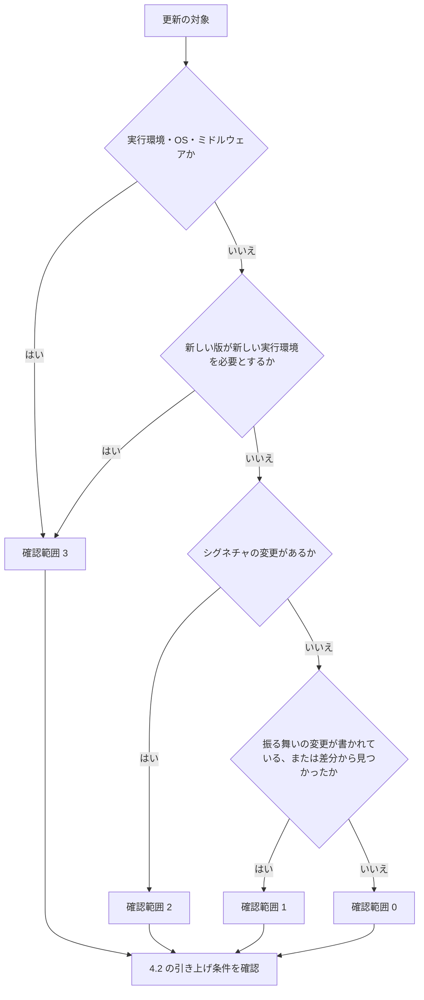
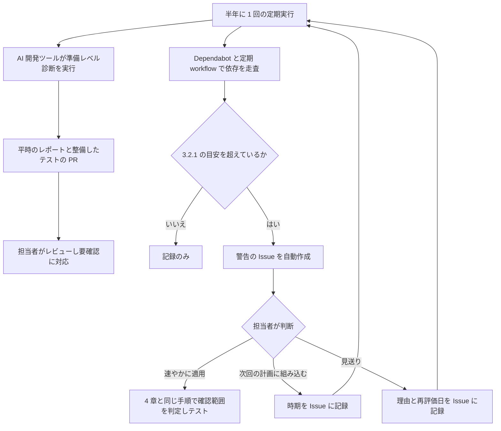

# 脆弱性パッチ適用時の無影響確認テスト ガイドライン

> 対象読者: アプリケーション開発チーム
> 目的: 平時から不足するテストを充足し、CVE 公開時に 48 時間以内に無影響確認を経て本番リリースできる体制を整える
> ステータス: PoC / ドラフト

## 1. 目的・適用範囲・前提

### 1.1 目的

アプリを構成するソフトウェアに CVE（公開された脆弱性）が見つかると、提供元から緊急パッチが出る。パッチを当てた後は、アプリの動作が変わっていないこと（**無影響確認**）を短時間で確かめなければならない。

このガイドラインの目的は、各開発チームが平時の内から自らのアプリに足りないテストを把握し、不足する分を予め充足しておくことと、いざ CVE が公開されパッチが提供された際に、迅速（48 時間以内）に自システムにパッチを当てて本番リリースを行えるように体制を整えておくこと、そのために直ちに無影響確認を実施できるようにしておくことを目指すことである。アプリによって、自動テストがほぼ網羅されているものから、まったくないものまである。どのアプリでも、CVE が公開されたときに不足分だけを至急で追加し、期限内に無影響確認を終えられる状態を目指す。

### 1.2 適用範囲

| 項目 | 対象 |
|---|---|
| 言語 | Java・Python・TypeScript・C# |
| アプリの種類 | バックエンド・バッチ処理・Web フロントエンド・デスクトップアプリ |
| 更新の種類 | CVE が見つかったオープンソースのライブラリ、ミドルウェア、OS、実行環境 |

### 1.3 前提

- **期限。** CVE の検知から、分析・方針決定・実装・テスト・ビルド・ステージング環境へのデプロイまでを **24 時間以内** に行う。本番への反映を含めた全体の期限は **48 時間** とする。24 時間のうち、テストの追加と実行に使えるのは 12 時間を目安とする。
- **CI。** すべてのチームで、GitHub Actions による CI/CD の整備を必須とする。
- **役割。**

  | 役割 | 担う内容 |
  |---|---|
  | 開発チーム | テストの整備・実行、レポートの作成 |
  | 開発チームのリーダー | 確認範囲の判定、想定どおりの差分の承認、PR の承認、次長以上へのエスカレーション |
  | 次長以上 | 性能が不合格の項目を業務上許容するかの判断（暫定合格。6.3 のバッチの処理時間枠による暫定合格を除く）、期限の超過を認めるかの判断（4.5）、エスカレーションへの対応（3.1.1・7 章） |
  | 担当者 | 定期の乖離チェックで警告が出たときの対応方針の判断（3.2.2） |

  システムの停止やネットワークからの遮断の判断は、別途定める意思決定フローで行う。開発チームは停止の判断を行わない。

### 1.4 ガイドラインの構成

このガイドラインは、**平時の恒久準備**（3 章）と **CVE 公開後の至急対応**（4 章）の 2 つに分かれる。至急対応を期限内に終えられるかどうかは、平時の準備でほぼ決まる。

| 章 | 内容 | 使う時期 |
|---|---|---|
| 2 | パッチの分類（確認範囲 0〜3） | 平時・至急対応 |
| 3 | 平時の恒久準備 | 平時 |
| 4 | CVE 公開後の至急対応（追加テスト基準） | 至急対応 |
| 5 | 確認観点チェックリスト | 平時・至急対応 |
| 6 | 性能劣化の判定基準 | 平時・至急対応 |
| 7 | 着手前に収集する情報 | 至急対応 |
| 8 | GitHub Actions への組み込みと PR 判断基準 | 平時・至急対応 |
| 9 | 付録（ツール一覧・参考文献・workflow のひな形） | 平時 |

### 1.5 用語

| 用語 | 意味 |
|---|---|
| 無影響確認 | パッチを当てた後も、アプリとしての動作が変わっていないことを確かめること |
| 確認範囲 | 無影響確認に必要なテストの広さに応じたパッチの分類（2 章） |
| 機能テスト | パッチを当てる前の入出力を記録しておき、パッチを当てた後の入出力と比べるテスト。正しさではなく「変わっていないこと」を確かめる |
| 呼び出し箇所 | アプリのコードの中で、更新対象のライブラリを呼んでいる箇所 |
| 不安定なテスト | flaky テストとも呼ぶ。コードを変えていないのに、実行するたびに成功したり失敗したりするテスト（3.4） |
| SBOM | ソフトウェアの部品表。アプリが使っているライブラリとそのバージョンの一覧 |
| SCA | ソフトウェア構成分析。依存しているライブラリに既知の脆弱性がないかを調べるスキャン |
| 暫定合格 | 基準を満たさないが、定められた判断によりリリースを許可すること。後日の調査・改善を前提とする |
| シグネチャ | メソッドや関数の名前、引数の数・型・順序、戻り値の型など、呼び出し方を決める情報 |
| 破壊的変更 | シグネチャの変更など、アプリのコードを直さないと動かなくなる変更 |
| 間接依存 | アプリが直接使っているライブラリが、さらに使っているライブラリ |
| lock ファイル | 間接依存も含めて、実際に使うライブラリのバージョンを固定したファイル（`package-lock.json`・`poetry.lock`・`packages.lock.json` など） |
| LTS | Long Term Support。提供元が長期間のサポートを約束している版の系列 |
| CVSS | 脆弱性の深刻度を 0.0〜10.0 で表す共通の評価基準。このガイドラインでは、基本値 9.0 以上を「深刻度が高い」として扱う（4.2） |
| スモークテスト | 起動や主要な入口が応答するかだけを短時間で確かめる、最小限のテスト |
| 結合テスト | 複数の部品を組み合わせて、業務の流れが正しく動くかを確かめるテスト |
| 契約テスト | 外部のシステムとのやりとり（API・ファイル・DB の構造）の形が守られているかを確かめるテスト |
| E2E テスト | 画面の操作から処理の結果までを、利用者と同じ経路で通して確かめるテスト |

## 2. パッチの分類

パッチは、無影響確認に必要なテストの広さに応じて **確認範囲 0〜3** に分類する。確認範囲が大きいほど、4 章で追加するテストが増える。

### 2.1 確認範囲の定義

| 確認範囲 | 定義 | 例 |
|---|---|---|
| 0 | ライブラリの更新で、シグネチャの変更がなく、振る舞いの変更もない（リリースノートに書かれておらず、更新前後の差分からも見つからない） | 脆弱性の修正だけを含むパッチリリース |
| 1 | ライブラリの更新で、シグネチャの変更はないが、振る舞いの変更（デフォルト設定・入力検証・出力形式など）がある（リリースノートに書かれている、または更新前後の差分から見つかった） | 安全のためにデフォルト設定が厳しくなったパッチ |
| 2 | ライブラリの更新で、シグネチャの変更（破壊的変更）があり、アプリのコードの修正が必要 | メソッドの削除・引数の変更を含むバージョンアップ |
| 3 | 実行環境・OS・ミドルウェアの更新 | JDK・Python・Node.js・.NET の更新、OS・コンテナのベースイメージの更新、DB の更新 |

### 2.2 判定の手順

確認範囲は **開発チームのリーダー** が判定し、判定した確認範囲と理由をレポートに記録する。判定の根拠となる情報（リリースノート、更新前後の差分、移行ガイドなど）は 7 章の手順で集める。



### 2.3 判定の注意点

- **複数の更新を同時に行う場合** は、その中で最も大きい確認範囲に合わせる。
- **ライブラリの新しい版が新しい実行環境を必要とする場合**（例: 新しい版が新しい JDK を前提にしている）は、確認範囲 3 として扱う。
- **コンテナのベースイメージの更新** は、OS の更新として確認範囲 3 で扱う。
- **言語によって、シグネチャの変更の見つけやすさが違う。** Java・C# では、シグネチャの変更はコンパイルエラーとして現れる。Python や、型チェックが緩い TypeScript では、実行するまで気づけないことがある。そのため、Python・TypeScript では「シグネチャの変更がない」と判断する前に、呼び出し箇所を実際に通るテストを実行して確かめる。
- 判定した確認範囲を引き上げる条件は 4.2 で定める。

## 3. 平時の恒久準備

CVE 公開後の至急対応（4 章）を時間内に終えられるかどうかは、平時の準備でほぼ決まる。この章では、CVE が公開される **前に** 整えておくべきことを定める。

### 3.1 最小限の自動テストの整備

#### 3.1.1 準備レベル

各チームは自分のアプリがどのレベルにあるかを判定し、不足している項目を把握する。全チームの当面の目標は **L2**、最終目標は **L3** とする。

| 準備レベル | 状態 | 4 章で対応できる確認範囲 |
|---|---|---|
| L0 | 自動テストがない、または CI で動いていない | どの確認範囲も時間内に対応できない |
| L1 | 下表の L1 項目がすべて CI で動いている | 確認範囲 0 のみ（呼び出し箇所のテストを至急で追加する必要がある） |
| L2 | L1 と L2 の項目がすべて CI で動いている | 確認範囲 0〜2 |
| L3 | L1〜L3 の項目がすべて CI で動いている | 確認範囲 0〜3 |

| 準備内容 | 項目 | 準備レベル | 内容 |
|---|---|---|---|
| P1 | 依存ライブラリの一覧（SBOM） | L1 | 別の手順で生成されている SBOM（ソフトウェアの部品表）を、ビルドのたびに参照する |
| P2 | 脆弱性スキャン | L1 | 依存ライブラリの脆弱性スキャン（SCA）を CI で実行する |
| P3 | 起動スモークテスト | L1 | アプリを起動し、主要な入口（API・画面・バッチ起動）が応答することを確かめる |
| P4 | 呼び出し箇所一覧 | L2 | アプリが外部ライブラリを呼んでいる箇所の一覧を作り、コードの変更に合わせて更新する |
| P5 | 呼び出し箇所の機能テスト | L2 | P4 の呼び出し箇所ごとに、入出力を記録して比較する機能テストを用意する |
| P6 | 主要業務フローの結合テスト | L2 | アプリの主要な業務の流れを確かめる結合テストを 3〜5 本用意する |
| P7 | パッチ前後比較の workflow | L2 | 同じテストをパッチ前後の両方のバージョンで実行する GitHub Actions の workflow のひな形を用意する（8 章・9.3） |
| P8 | 外部連携の契約テスト | L3 | 外部とのやりとり（API・ファイル・DB の構造）の形が守られていることを確かめる。選択的に外してよい |
| P9 | E2E スモークテスト | L3 | Web 画面・デスクトップ画面を実際に操作する最小限のテスト。選択的に外してよい |
| P10 | 確認範囲 3 向け環境確認 | L3 | 3.3 を参照 |
| P11 | 性能ベースラインと不安定なテストの管理 | L3 | 3.4 を参照。性能テストは選択的に外してよい |

選択的に外した項目は、その理由とともに無影響確認テスト実施レポートに記録する（4.6 のとおり残存リスクとして扱う）。理由を記録して外した項目は、準備レベルの判定では満たしたものとみなす。

自チームの準備レベルでは時間内に対応できない確認範囲のパッチが来た場合でも、対応は免れない。開発チームのリーダーは直ちに次長以上にエスカレーションしたうえで、対応を続ける。エスカレーションの内容は、別途進めている現状の可視化の枠組みで報告する。

#### 3.1.2 アプリ種別ごとの重点

| アプリ種別 | P3 起動スモークの入口 | P6 主要業務フローの例 | P8・P9 の観点 |
|---|---|---|---|
| バックエンド | ヘルスチェック API・主要 API | 認証 → 主要な更新処理 → 参照 | API の契約テスト |
| バッチ処理 | 小さな入力データでのジョブ起動 | 入力ファイル → 変換 → 出力・DB 更新 | 入出力ファイルの形式 |
| Web フロントエンド | トップ画面の表示 | ログイン → 主要な画面操作 | ブラウザでの E2E スモーク |
| デスクトップアプリ | アプリの起動と初期画面 | 主要な画面操作 | 画面操作の E2E スモーク・インストーラーの作成 |

### 3.2 LTS 版とのバージョン乖離の解消

バージョンの乖離が大きいほど、CVE が出たときのパッチは破壊的変更を含みやすくなり、確認範囲 2 以上になる可能性が高まる。**小さく、こまめに更新して乖離をためない** ことが、至急対応を短くする最も効果的な準備である。

#### 3.2.1 乖離の目安

| 対象 | 目安 |
|---|---|
| 実行環境（JDK・Python・Node.js・.NET） | 提供元のサポート期間内の系列を使う。LTS がある場合は LTS 系列に乗せる。サポート終了の 6 か月前までに次の系列への移行計画を立てる |
| フレームワーク（Spring Boot・Django・React・ASP.NET Core など） | 提供元のサポート期間内の系列を使う |
| ライブラリのパッチ・マイナー更新 | 最新リリースから 1 年以上遅れない |
| ライブラリのメジャー更新 | 最新から 1 メジャー以内。メジャー更新は計画を立てて別に進める |
| OS・コンテナのベースイメージ | 提供元のサポート期間内のものを使い、半年に 1 回は最新のイメージで作り直す |
| 更新が止まったライブラリ | 1 年以上リリースがないもの、サポートが終了したものは代替を検討する |

これらは目安であり、アプリの事情に応じて調整してよい。調整した場合は理由を記録する。

#### 3.2.2 定期の乖離チェックの流れ



1. **走査。** Dependabot のバージョン更新を半年に 1 回（`schedule.interval: semiannually`）で動かす。あわせて、実行環境・フレームワーク・ベースイメージのサポート終了日を確認する定期 workflow を GitHub Actions で半年に 1 回動かす。
2. **警告。** 3.2.1 の目安を超えているものがあれば、警告の Issue を自動で作る。
3. **判断。** 担当者が Issue を見て、「速やかに適用」「次回の計画に組み込む」「見送り」のいずれかを決め、Issue に記録する。見送る場合は理由と再評価日を必ず書く。
4. **適用。** 適用する場合は、4 章と同じ手順で確認範囲を判定し、テストを行う。ただし至急対応ではないので、時間の上限はない。
5. **準備レベル診断。** 定期実行では、AI 開発ツールが無影響確認テストのスキルを対話なしで実行し（`/patch-regression-test readiness --auto`）、平時のレポート（`patch-regression-reports/readiness-<日時>.md`）と整備したテストを PR にする。担当者は PR をレビューし、レポートの「要確認」に対応する。
   - 対話なしの実行は、人とツールが事前に少なくとも 1 回は対話で実行し、その回答を設定ファイル（`patch-regression-reports/auto-settings.md`）に保存していることを前提とする。
   - アプリ本体のコードの修正と、期待値の更新は、対話なしの実行では行わない。必要な場合はレポートの「要確認」に記載される。

Dependabot のセキュリティ更新（脆弱性が見つかったときに自動で出る PR）は、定期の走査とは別に常に有効にしておく。

### 3.3 確認範囲 3 向け環境確認の CI 自動化

実行環境・OS・ミドルウェアの更新（確認範囲 3）は、4.5 のとおり、準備がなければシステムの停止を伴う。次の確認を CI で自動実行できる状態にしておく。

| 確認内容 | 例 |
|---|---|
| 配布物の作成 | コンテナイメージ・インストーラーが作れる |
| TLS と証明書 | 外部接続で TLS のハンドシェイクが成功する。社内 CA の証明書が読み込まれる |
| ロケールとタイムゾーン | 日付・数値の書式、タイムゾーンの変換が変わらない |
| 文字コード | ファイルや標準入出力の既定の文字コードが変わらない |
| ファイル入出力 | パス・改行コード・権限の扱いが変わらない |
| ミドルウェア | DB・メッセージキューなどをバージョンを指定してテスト用に起動し、接続と主要な操作ができる |
| OS 更新の予行練習 | ベースイメージを最新にして CI を通す（3.2.1 の半年に 1 回の作り直しと兼ねる） |

デスクトップアプリのインストーラー作成など、CI で動かす方法がアプリによって大きく異なるものは、各チームの判断で実装する。

### 3.4 性能ベースライン計測と不安定なテストの洗い出し

- **性能ベースライン。** 6 章の指標を定期的に（少なくとも半年に 1 回、3.2.2 の走査と同時に）計測し、CI の成果物として保存する。パッチ適用後の比較対象になる。
- **不安定なテスト。** 不安定なテスト（flaky テスト）とは、コードを変えていないのに、実行するたびに成功したり失敗したりするテストのことである。原因には、時刻や乱数への依存、テスト同士の実行順序への依存、外部サービスの応答の揺れなどがある。至急対応の最中に不安定なテストが失敗すると、パッチの影響なのかどうかを判断できない。そのため、平時に同じテストを複数回実行して不安定なテストを見つけ、一覧にしておく。一覧にあるテストは原因を直すまで判定から区別する。
- **非決定的な値の扱い。** 時刻・乱数・ID など実行のたびに変わる値を比較の前に伏せる方法を、テストごとに事前に決めておく。
- **予行演習。** 模擬の CVE を使って、検知からステージングへのデプロイまでを 24 時間以内に行う訓練を、定期的に実施することが望ましい。

## 4. CVE 公開後の至急対応（追加テスト基準）

CVE が公開されパッチが提供された後に、無影響確認のために **至急で** 追加・実行するテストの範囲を定める。平時の準備（3 章）が整っていることを前提とし、ここでは「何を足し、何をもって合格とするか」だけを扱う。

### 4.1 基本原則

1. **バージョン番号を信用しない。** パッチリリースでも破壊的変更は珍しくない（Maven ではパッチリリースの 23.8%、マイナーリリースの 35.7% に破壊的変更があったという報告がある）。シグネチャが変わらなくても、振る舞いは確認する。
2. **迷ったら確認範囲を広げる。** 影響範囲を特定しきれない場合は、テストを絞らずに確認範囲を 1 段上げて扱う（4.2）。
3. **行カバレッジより呼び出し箇所。** 守るべきは「アプリが更新対象を使っている箇所」である。カバレッジの数値が高くても、呼び出し箇所を通るテストがなければ不足とみなす。
4. **時間の上限を守る。** 検知からステージングへのデプロイまでの 24 時間のうち、テストの追加と実行に使えるのは **12 時間** を目安とする。

### 4.2 確認範囲を引き上げる条件

次のいずれかに当てはまる場合、2 章で判定した確認範囲を 1 段上げて扱う。

- パッチ適用に伴い、間接依存のライブラリのバージョンも変わる
- CVSS の基本値が 9.0 以上で、脆弱な機能をアプリが実際に使っている
- リリースノートや差分が不十分で、影響範囲を特定できない

当てはまる条件の数にかかわらず、引き上げは 1 段とする。「脆弱な機能をアプリが実際に使っている」かどうかは、呼び出し箇所一覧（P4）と脆弱性情報（I2）を照らし合わせて判断する。

### 4.3 全確認範囲共通の最低限

| チェック内容 | 項目 | 合格条件 |
|---|---|---|
| C1 | ビルド・静的解析 | エラーなし。依存ツリーをパッチ前後で比較し、意図しない更新がない |
| C2 | 起動スモークテスト | アプリが起動し、主要な入口（API・画面・バッチ起動）が応答する |
| C3 | 既存の自動テストの全件実行 | 3.4 の一覧にある不安定なテストを除き、すべて成功する |
| C4 | 脆弱性スキャン（SCA）の再実行 | 対象 CVE が検出されなくなっている |
| C5 | 脆弱性の修正確認テスト | 攻撃を再現する入力が拒否される（公開情報から再現入力を作れる場合） |
| C6 | 性能 | 6 章のしきい値の範囲内（性能テストを選択的に外した場合は対象外とし、残存リスクとして記録する） |

### 4.4 確認範囲別の追加テスト

| 確認範囲 | 対象 | 共通の最低限に加えて行うこと |
|---|---|---|
| 0 | ライブラリの更新で、シグネチャの変更も振る舞いの変更もない | 更新対象の **呼び出し箇所** を洗い出し、そこを通るテストがあることを確認する。なければ追加する |
| 1 | ライブラリの更新で、シグネチャの変更はないが、振る舞いの変更がある | 確認範囲 0 に加えて、呼び出し箇所に **機能テスト** を置く。パッチ適用前に入出力を記録し、適用後と比較する |
| 2 | ライブラリの更新で、シグネチャの変更（破壊的変更）があり、アプリのコードの修正が必要 | 確認範囲 1 に加えて、変更された API について **ライブラリ側の挙動の違い** を分析する。そのうえで、アプリとしては同じ入力に同じ結果を返すことを確かめるテストを書く。修正したコードには、変更箇所に絞った単体テストを書く |
| 3 | 実行環境・OS・ミドルウェアの更新 | 4.5 を参照 |

### 4.5 確認範囲 3 を至急対応で扱う場合

確認範囲 3 の環境確認（コンテナイメージやインストーラーの作成、TLS と証明書、ロケールとタイムゾーン、文字コード、ファイル入出力）は、本来 3.3 の恒久準備として CI に組み込んでおくものである。

3.3 の準備がないまま、やむを得ず至急対応で確認範囲 3 を扱う場合は、次の手順を取る。

1. 開発チームのリーダーは、直ちに次長以上にエスカレーションする。対象システムを **停止またはネットワークから遮断** するかどうかは、別途定める意思決定フローで判断される。開発チームは停止の判断を行わない。
2. 3.3 の環境確認を **恒久対応と同じ水準で** 実施する。検知からステージングへのデプロイまでの 24 時間（本番反映を含めた全体の期限は 48 時間）を超えるおそれがある場合でも、開発チームの判断で確認を省略したり、期限の超過を決めたりしてはならない。期限の超過を認めるかどうかは、エスカレーションを受けた次長以上が判断する。
3. 脆弱性の除去と無影響が確認できたら、その結果を報告する。システムを停止・遮断していた場合、稼働の再開は意思決定フローに従う。

システムを停止・遮断した場合、その時間がそのままビジネス上の損失になる。**停止時間を短くする唯一の手段は、平時に 3.3 を整えておくことである。**

### 4.6 判定のルール

- **想定どおりの差分。** 脆弱性の修正によって意図的に変わった挙動（例: 悪意のある入力を拒否するようになった）は、理由を記録し、**開発チームのリーダー** の承認を受ける。承認のない差分が 1 つでもあれば不合格とする。
- **除外したテストレベル。** 選択的に外したテストレベル（E2E・契約テスト・性能テストなど）は、残存リスクとしてレポートに記載する。
- **パッチ前後での同一テストの実行。** 同じテストをパッチ前とパッチ後の両方のバージョンで実行し、結果を比べる（GitHub Actions のマトリクスを使う。8 章を参照）。
- **非決定的な出力。** 時刻・乱数・ID など実行のたびに変わる値は、比較の前に伏せる（3.4）。不安定なテストは 3.4 で事前に把握しておき、結果の判定から区別する。

## 5. 確認観点チェックリスト

シグネチャが変わらなくても、振る舞いは変わることがある。とくに脆弱性の修正では、安全側に倒した変更が既存の動作に影響しやすい。無影響確認では、次の観点を確認範囲に応じて確認する。「対象の確認範囲」が「全確認範囲」の観点は、確認範囲 0 でも確認する。

| 確認観点 | 項目 | 起きやすい変化の例 | 対象の確認範囲 | 確認方法 |
|---|---|---|---|---|
| V1 | 起動とデプロイ | 起動しない、設定ファイルを読めない、配布物が作れない | 全確認範囲 | C1 ビルド・C2 起動スモーク |
| V2 | 間接依存の変化 | パッチに伴い、別のライブラリのバージョンも変わる | 全確認範囲 | C1 の依存ツリーの比較 |
| V3 | 脆弱性の修正 | 修正が効いていない | 全確認範囲 | C4 脆弱性スキャン・C5 修正確認テスト |
| V4 | デフォルト設定の変更 | TLS のバージョン、デシリアライズの許可リスト、XML の外部実体参照（XXE）、Cookie の属性の既定値が厳しくなる | 確認範囲 1 以上 | 呼び出し箇所の機能テスト |
| V5 | 入力検証の厳格化 | 以前は受け付けていた不正な形式・文字コード・パスが拒否される | 確認範囲 1 以上 | 既存データ・境界値を使った機能テスト |
| V6 | 出力形式の変化 | JSON・XML・日付・数値・null の表現、項目の順序が変わる | 確認範囲 1 以上 | 出力を比較する機能テスト・契約テスト |
| V7 | 例外とエラーの変化 | 例外の型、エラーメッセージ、エラーコードが変わり、呼び出し側のエラー処理が想定どおりに動かない | 確認範囲 1 以上 | 異常系の機能テスト |
| V8 | ログと監視 | ログの形式が変わり、ログを使った監視・監査が動かない | 確認範囲 1 以上 | ログ出力を比較する機能テスト |
| V9 | 並行処理とリソース | スレッドの扱い、接続プール、メモリ使用量が変わる | シビアな性能を求めるシステムのみ、実施を検討する | 6 章の性能確認 |
| V10 | 破壊的変更への対応 | 修正したコードで、アプリとしての結果が変わる | 確認範囲 2 以上 | 修正箇所の単体テスト・パッチ前後で同じ結果を返すことの確認 |
| V11 | 実行環境・OS に固有の変化 | 証明書ストア、ロケール・タイムゾーンのデータ、既定の文字コード、ファイル操作の挙動が変わる | 確認範囲 3 | 3.3 の環境確認 |

どの観点でも、差分が見つかった場合は 4.6 のとおり扱う。脆弱性の修正によって意図的に変わった挙動は、理由を記録したうえで開発チームのリーダーの承認を受ける。

## 6. 性能劣化の判定基準

パッチの適用によって性能が著しく劣化していないかを判定する基準を定める。業界で決まった標準値はないため、ここでは **初期値** を示す。アプリの事情に応じて調整してよいが、調整した場合は理由を記録する。

### 6.1 測る指標

| アプリ種別 | 指標 |
|---|---|
| バックエンド | 応答時間の 95 パーセンタイル（p95）、スループット（一定時間に処理できる件数） |
| バッチ処理 | 処理時間 |
| Web フロントエンド | 画面が表示されるまでの時間、配信するファイルの大きさ |
| デスクトップアプリ | 全種別共通の指標のみ |
| 全種別共通 | 起動時間、メモリ使用量の最大値 |

p95 とは、すべてのリクエストを速い順に並べたときに 95% 目にあたる応答時間のことである。平均よりも、一部の遅いリクエストの悪化に気づきやすい。

### 6.2 しきい値（初期値）

| 判定 | 条件 |
|---|---|
| 合格 | 劣化が +10% 未満 |
| 警告 | 劣化が +10% 以上 +20% 未満。レポートに記載する |
| 不合格 | 劣化が +20% 以上 |
| 要確認 | 30% 以上 **良く** なった。処理が飛ばされていないかを調べ、問題がなければ合格とする |

- **劣化の向き。** 応答時間・処理時間・起動時間・画面表示時間・メモリ使用量・配信するファイルの大きさは、値が **増えたら** 劣化とする。スループットは、値が **減ったら** 劣化とする。劣化の割合は「パッチ後とパッチ前の差 ÷ パッチ前の値」で計算する。
- **絶対値の下限。** パッチ前後の **差** がごく小さいものは、割合が大きくても劣化とみなさない。初期値は、応答時間の差が 1 秒未満、バッチの処理時間の差が 5 分未満とする。
- **不合格のときの扱い。** 不合格の項目がある場合は、開発チームのリーダーが内容を確認し、次長以上にエスカレーションする。次長以上が業務上許容できると判断した場合は **暫定合格** とする。その場合は、判断の理由と劣化の値をレポートに残存リスクとして記録する。ただし、6.3 のバッチが処理時間枠に収まった場合の暫定合格は、次長以上の判断を要しない。

### 6.3 測り方

- **パッチ前後を続けて測る。** 同じ CI の実行の中で、パッチ前とパッチ後を続けて測る。過去に保存したベースライン（3.4）だけと比べると、マシンの差が結果に混ざるためである。保存したベースラインは、長期的な傾向を見るために使う。
- **画面とサービス（バックエンド・Web フロントエンド・デスクトップアプリ）は、繰り返して中央値をとる。** ウォームアップ（準備運転）をしてから 5 回測り、中央値で比べる。
- **バッチ処理は、制限時間内に収まるかで判定する。** 長時間かかるバッチもあるため、繰り返し測ることを前提にしない。制限時間は、6.2 の不合格のしきい値（パッチ前の処理時間の +20%。ただし差が 5 分未満なら劣化とみなさない）とする。
  1. 1 回目の実行が制限時間内に収まれば **合格** とする。
  2. 収まらなかった場合は再実行し、最大 3 回まで実施する。いずれかの回で収まれば **合格** とする。
  3. 3 回とも収まらなかった場合は、処理時間が **運用上決められたバッチの処理時間枠**（例: 夜間の 2 時〜5 時に終わること）に収まっているかを追加で確認する。
     - 処理時間枠に収まっている場合は **暫定合格** とし、リリースを許可する。ただし、後日あらためて性能劣化の原因を調査し、早急に性能の改善を図る。暫定合格とした理由と、調査・改善の予定をレポートに記録する。
     - 処理時間枠に収まらない場合は **不合格** とし、6.2 の「不合格のときの扱い」に従う。
- **同じ種類のランナーで測る。** GitHub が用意するランナーは測定値がぶれやすい。厳密な比較が必要なアプリでは、自前のランナー（self-hosted runner）を検討する。
- 性能テストは選択的に外してよい（3.1.1）。外した場合は、4.6 のとおり残存リスクとしてレポートに記載する。

## 7. 着手前に収集する情報

分析やテストの実装を始める前に、次の情報をそろえる。

**必須** の情報が欠けていても、対応を止めることはしない。欠けている情報が何かをレポートに明記し、開発チームのリーダーに追加の判断を求める（リーダーが判断できない場合は次長以上にエスカレーションする）。判断を待つ間は、4.1 の「迷ったら確認範囲を広げる」に従い、確認範囲を 1 段上げて作業を進める。

| 情報分類 | 項目 | 情報の種類 | 区分 | 使い道 |
|---|---|---|---|---|
| I1 | 脆弱性 | CVE 番号 | 必須 | 対象の特定 |
| I2 | 脆弱性 | 脆弱性情報（NVD・GHSA など）、CVSS、影響を受ける関数や機能 | 必須 | アプリが脆弱な機能を実際に使っているかの判断（4.2）、修正確認テストの作成（C5） |
| I3 | 変更内容 | 更新対象と、更新前後のバージョン | 必須 | 確認範囲の判定（2 章） |
| I4 | 変更内容 | リリースノート、変更履歴、移行ガイド | 必須 | 破壊的変更・振る舞いの変更の有無の判断 |
| I5 | 変更内容 | 更新前後のソースの差分 | 確認範囲 1 以上で推奨 | リリースノートに書かれていない振る舞いの変更の発見 |
| I6 | 依存関係 | lock ファイル、依存ツリー、一緒に更新される間接依存 | 必須 | 影響範囲の把握（V2）、確認範囲の引き上げの判断（4.2） |
| I7 | 対象アプリ | リポジトリ、言語、アプリ種別、外部との接続先（DB・API・ファイル） | 必須 | テストの設計とツールの選択 |
| I8 | 現在のテスト | テストコード、GitHub Actions の workflow、準備レベル（3.1.1） | 必須 | 不足しているテストの洗い出し |
| I8a | 現在のテスト | カバレッジのレポート | 任意（あるほうが望ましい） | 不足しているテストの洗い出しの補助 |
| I9 | 性能 | 性能ベースライン（3.4） | 任意 | 長期的な傾向との比較。なければパッチ前に計測する（6.3） |
| I10 | 実行条件 | 選択的に外すテストレベルとその理由 | 任意 | 作業範囲の決定、残存リスクの記録（4.6） |
| I11 | 実行条件 | ステージング環境の有無と接続方法 | E2E スモークテストを実施する場合は必須 | E2E スモークテストの実施可否 |
| I12 | 実行条件 | CVE の検知時刻と期限（24 時間・48 時間） | 必須 | 作業の時間配分 |
| I13 | 体制 | 確認範囲の判定と差分の承認を行う開発チームのリーダー、エスカレーション先の次長以上 | 参考情報（要確認事項） | 判定と承認の依頼先 |

#### 脆弱性情報の置き場所

脆弱性情報（I1・I2・I4・I5）は、パッチの適用や脆弱性情報の収集を担うツール・人が、対象アプリのリポジトリの **GitHub Issue** に記載する。

- Issue のタイトルには、必ず CVE 番号を含める（例: `[CVE-2026-12345] xxx ライブラリの脆弱性対応`）。無影響確認を行う人やツールは、CVE 番号でこの Issue を探す。
- 1 つの Issue で複数の CVE をまとめて扱う場合は、タイトルにすべての CVE 番号を含める。
- Issue が見つからない場合は、無影響確認を行う人に情報を直接渡す。

収集した情報と、その入手元は、無影響確認テスト実施レポートの冒頭に記録する。

## 8. GitHub Actions への組み込みと PR 判断基準

4 章の確認を GitHub Actions で自動実行し、その結果を PR のマージ判断に使う。ステージング環境へのデプロイは、各チームの既存の CD に任せ、このガイドラインの対象外とする。

### 8.1 workflow の構成

workflow のひな形は付録 9.3 に示す（3.1.1 の P7）。

- **起動のきっかけ。** 次の 3 つで起動する。
  - 依存関係のファイル（lock ファイル・`pom.xml`・`*.csproj`・`Dockerfile` など）を変更する PR（`pull_request` の `paths` で絞る）。Dependabot のセキュリティ更新の PR もこれに含まれる
  - 無影響確認テスト実施レポート（`patch-regression-reports/` の中のファイル）を変更する PR。平時のレポートを含む PR（3.2.2）もこれに含まれる
  - 手動起動（`workflow_dispatch`）。Dependabot が対応していない更新（実行環境・OS・ミドルウェアなど）に使う
- **ジョブの構成。** 次のジョブで構成する。「先に終わっている必要があるジョブ」がないジョブは、並列に実行してよい。

  | ジョブ | 内容 | 対応する確認 | 先に終わっている必要があるジョブ |
  |---|---|---|---|
  | build | ビルドと静的解析、依存ツリーの比較 | C1 | なし |
  | scan | 脆弱性スキャンと SBOM の参照 | C4・P1 | なし |
  | test | 起動スモークテスト、既存の自動テストの全件実行、修正確認テスト | C2・C3・C5 | build |
  | compare | パッチ前後の比較（機能テスト・契約テスト・E2E スモーク） | 4.4 | build |
  | perf | 性能の測定 | C6・6 章 | build |
  | report | 無影響確認テスト実施レポートへの CI の結果の追記と投稿 | 8.3 | すべて |

- **パッチ前後で同じテストを動かす。** パッチ前は **比較元ブランチ**、パッチ後は PR のブランチを取得し、同じテストを `matrix: [before, after]` で実行する。比較元ブランチはアプリごとに選べるようにする（リポジトリ変数 `PATCH_BASELINE_BRANCH` で指定し、手動起動のときは入力値で上書きできる。指定がなければ PR のマージ先ブランチを使う）。
- **選択的に外せるジョブ。** 契約テスト・E2E スモーク・性能テストは、リポジトリ変数または手動起動の入力値で外せるようにする。外した場合は、レポートの「残存リスク」に自動で記載する（4.6）。
- **比較の材料を保存する。** 機能テストで記録した入出力と性能の測定結果は、CI の成果物（artifact）として保存する。
- **不安定なテストの扱い。** 3.4 の一覧にあるテストの結果は「参考」として分けて表示し、合否の判定には含めない。

### 8.2 PR の記載事項

PR のテンプレートに、次の欄を用意する。

- 脆弱性情報を記載した Issue へのリンク（7 章）
- 確認範囲の判定結果と、その理由（2 章）
- 収集した情報とその入手元（7 章）
- 想定どおりの差分と、開発チームのリーダーの承認（4.6）
- 選択的に外したテストレベルと、その理由（3.1.1）
- 残存リスク（暫定合格の理由を含む）
- CVE の検知時刻と期限（24 時間・48 時間）

### 8.3 レポートの置き場所

無影響確認テスト実施レポートの本体は、無影響確認テストのスキル（`patch-regression-test`）が出力し、PR に含める（至急対応は `patch-regression-reports/urgent-<CVE 番号>.md`、平時は `patch-regression-reports/readiness-<日時>.md`）。workflow は、このレポートに CI の実行結果を追記したうえで、次の 2 か所に残す。

- **PR のコメント。** マージを判断する人がその場で読めるように、workflow が自動で投稿する。
- **CI の成果物（artifact）。** 後日、ダッシュボードなどから参照できるように保存する。保存期間（`retention-days`）は、社内の記録の保管方針に合わせて設定する。

### 8.4 マージの判断基準

PR の承認は **開発チームのリーダー** が行う。次の条件をすべて満たしていることを確認してから承認する。

- C1〜C6 がすべて合格、または暫定合格である（選択的に外した項目を除く）
- 想定どおりの差分は、すべてリーダーが承認している
- 性能が不合格の項目は、次長以上の判断（暫定合格）が記録されている（6.2。6.3 のバッチが処理時間枠に収まった場合の暫定合格を除く）
- 選択的に外したテストレベルは、理由とともに残存リスクとして記録されている

緊急時にやむを得ず手続きを省略する場合があるため、GitHub のブランチ保護による強制は必須としない。省略した場合は、その内容と理由をレポートに記録する。ただし、**開発チームのリーダー（社員）による PR の承認は省略できない。**

### 8.5 暫定合格の後の対応

暫定合格とした項目（6.2 の性能の暫定合格、6.3 のバッチの暫定合格など）がある場合は、劣化の原因の調査と改善のための Issue を作り、担当者と期限を決める。workflow から Issue を自動で作ることが望ましい。

## 9. 付録

### 9.1 言語別ツール一覧

代表的なツールの例を示す。すでに使っているツールがあれば、それを優先してよい。

| 用途 | Java | Python | TypeScript | C# |
|---|---|---|---|---|
| 単体・結合テスト | JUnit 5 | pytest | Jest・Vitest | xUnit・NUnit・MSTest |
| カバレッジ | JaCoCo | coverage.py（pytest-cov） | Istanbul（c8・nyc） | Coverlet |
| 機能テスト（入出力の記録と比較） | ApprovalTests.Java | syrupy・ApprovalTests.Python | Jest・Vitest のスナップショット | Verify |
| 依存ツリーの確認 | `mvn dependency:tree`・`gradle dependencies` | `pipdeptree` | `npm ls` | `dotnet list package --include-transitive` |
| 脆弱性スキャン（SCA） | OWASP Dependency-Check | pip-audit | `npm audit` | `dotnet list package --vulnerable` |
| E2E | Playwright（Web） | Playwright（Web） | Playwright（Web） | Playwright（Web）・FlaUI（デスクトップ） |
| 性能 | JMH・Gatling | pytest-benchmark・Locust | k6・Lighthouse CI | BenchmarkDotNet |

言語によらず使えるもの:

- **Dependabot**: 依存の更新 PR とセキュリティ更新（3.2.2）
- **dependency-review-action**: PR で追加・変更される依存の脆弱性を確認する GitHub Actions
- **Trivy**: コンテナイメージの脆弱性スキャン（確認範囲 3）

### 9.2 参考文献

- S. Raemaekers, A. van Deursen, J. Visser. "Semantic versioning versus breaking changes: A study of the Maven repository." SCAM 2014. https://research.tudelft.nl/en/publications/semantic-versioning-versus-breaking-changes-a-study-of-the-maven-
- "Breaking Changes in Software Ecosystems: A Systematic Literature Review." arXiv:2605.24397. https://arxiv.org/abs/2605.24397
- "Software Security Patch Management – A Systematic Literature Review of Challenges, Approaches, Tools and Practices." arXiv:2012.00544. https://arxiv.org/abs/2012.00544
- NIST SP 800-40 Rev. 4. "Guide to Enterprise Patch Management Planning." 2022. https://csrc.nist.gov/pubs/sp/800/40/final
- M. Feathers. *Working Effectively with Legacy Code.* Prentice Hall, 2004.（機能テストの考え方の出典。原著では characterization test と呼ぶ）
- Renovate. "Upgrade best practices."（Renovate のドキュメント。ミラー: https://git.shivering-isles.com/github-mirror/renovatebot/renovate/-/blob/0379788a19a9106fb4bf165181e7404eacc94aec/docs/usage/upgrade-best-practices.md ）
- 性能劣化のしきい値の事例: OneUptime "How to Use OpenTelemetry Metrics for Automated Performance Regression Detection." https://oneuptime.com/blog/post/2026-02-06-otel-metrics-performance-regression-cicd/view

### 9.3 workflow のひな形

`.github/workflows/patch-regression.yml` のひな形を示す。`TODO` の箇所は、アプリの言語とツールに合わせて置き換える。

```yaml
name: patch-regression

on:
  pull_request:
    paths:          # TODO: アプリの依存関係のファイルに合わせる
      - "**/pom.xml"
      - "**/build.gradle*"
      - "**/requirements*.txt"
      - "**/poetry.lock"
      - "**/package-lock.json"
      - "**/*.csproj"
      - "**/packages.lock.json"
      - "**/Dockerfile"
      - "patch-regression-reports/**"
  workflow_dispatch:
    inputs:
      baseline_branch:
        description: "比較元ブランチ（空なら PATCH_BASELINE_BRANCH またはマージ先ブランチ）"
        required: false
        type: string
      skip_contract:
        description: "契約テストを外す"
        type: boolean
        default: false
      skip_e2e:
        description: "E2E スモークテストを外す"
        type: boolean
        default: false
      skip_perf:
        description: "性能テストを外す"
        type: boolean
        default: false

permissions:
  contents: read
  pull-requests: write

env:
  BASELINE_BRANCH: ${{ inputs.baseline_branch || vars.PATCH_BASELINE_BRANCH || github.base_ref || 'main' }}

jobs:
  build:            # C1
    runs-on: ubuntu-latest
    steps:
      - uses: actions/checkout@v4
      # TODO: 言語のセットアップ（setup-java / setup-python / setup-node / setup-dotnet）
      - name: ビルドと静的解析
        run: echo "TODO"
      - name: 依存ツリーの出力（パッチ後）
        run: echo "TODO" > deps-after.txt
      - uses: actions/checkout@v4
        with:
          ref: ${{ env.BASELINE_BRANCH }}
          path: baseline
      - name: 依存ツリーの出力（パッチ前）と比較
        run: |
          echo "TODO" > deps-before.txt
          diff deps-before.txt deps-after.txt > deps-diff.txt || true
      - uses: actions/upload-artifact@v4
        with:
          name: deps-diff
          path: deps-diff.txt

  scan:             # C4・P1
    runs-on: ubuntu-latest
    steps:
      - uses: actions/checkout@v4
      - name: 脆弱性スキャンと SBOM の参照
        run: echo "TODO"

  test:             # C2・C3・C5
    needs: build
    runs-on: ubuntu-latest
    steps:
      - uses: actions/checkout@v4
      - name: 起動スモークテスト
        run: echo "TODO"
      - name: 既存の自動テストの全件実行と修正確認テスト
        run: echo "TODO"

  compare:          # 4.4 パッチ前後の比較
    needs: build
    runs-on: ubuntu-latest
    strategy:
      fail-fast: false
      matrix:
        variant: [before, after]
    steps:
      - uses: actions/checkout@v4
        with:
          ref: ${{ matrix.variant == 'before' && env.BASELINE_BRANCH || '' }}
      - name: 機能テスト（入出力の記録）
        run: echo "TODO"
      - name: 契約テスト
        if: ${{ !inputs.skip_contract && vars.PATCH_SKIP_CONTRACT != 'true' }}
        run: echo "TODO"
      - name: E2E スモークテスト
        if: ${{ !inputs.skip_e2e && vars.PATCH_SKIP_E2E != 'true' }}
        run: echo "TODO"
      - uses: actions/upload-artifact@v4
        with:
          name: compare-${{ matrix.variant }}
          path: TODO/output/

  perf:             # C6・6 章
    needs: build
    if: ${{ !inputs.skip_perf && vars.PATCH_SKIP_PERF != 'true' }}
    runs-on: ubuntu-latest
    steps:
      - uses: actions/checkout@v4
      - name: パッチ前後の性能測定（6.3 の測り方）
        run: echo "TODO"
      - uses: actions/upload-artifact@v4
        with:
          name: perf
          path: TODO/perf/

  report:           # 8.3
    needs: [build, scan, test, compare, perf]
    if: ${{ always() }}
    runs-on: ubuntu-latest
    steps:
      - uses: actions/checkout@v4
        with:
          fetch-depth: 0
      - name: スキルが出力したレポートを探し、CI の結果を追記する
        run: |
          files=$(git diff --name-only "origin/${BASELINE_BRANCH}...HEAD" -- 'patch-regression-reports/urgent-*.md' 'patch-regression-reports/readiness-*.md')
          if [ -n "$files" ]; then
            for f in $files; do
              cat "$f"
              printf '\n---\n\n'
            done > report.md
          else
            echo "無影響確認テスト実施レポートが PR に含まれていません。" > report.md
          fi
          {
            echo ""
            echo "## CI の実行結果"
            echo ""
            echo "| ジョブ | 結果 |"
            echo "|---|---|"
            echo "| build | ${{ needs.build.result }} |"
            echo "| scan | ${{ needs.scan.result }} |"
            echo "| test | ${{ needs.test.result }} |"
            echo "| compare | ${{ needs.compare.result }} |"
            echo "| perf | ${{ needs.perf.result }} |"
          } >> report.md
      - uses: actions/upload-artifact@v4
        with:
          name: patch-regression-report
          path: report.md
          retention-days: 90   # TODO: 社内の記録の保管方針に合わせる
      - name: PR にコメント
        if: ${{ github.event_name == 'pull_request' }}
        env:
          GH_TOKEN: ${{ github.token }}
        run: gh pr comment ${{ github.event.pull_request.number }} --body-file report.md
```

注意:

- Dependabot が作った PR で起動した workflow は、トークンの権限やシークレットの扱いが通常の PR と異なる場合がある。PR へのコメントの投稿が失敗する場合は、GitHub の公式ドキュメントで Dependabot 向けの設定を確認する。
- `actions/*` のバージョンは、導入時点の最新の安定版を確認して指定する。
