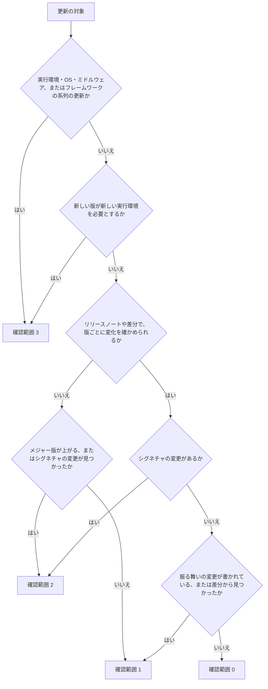
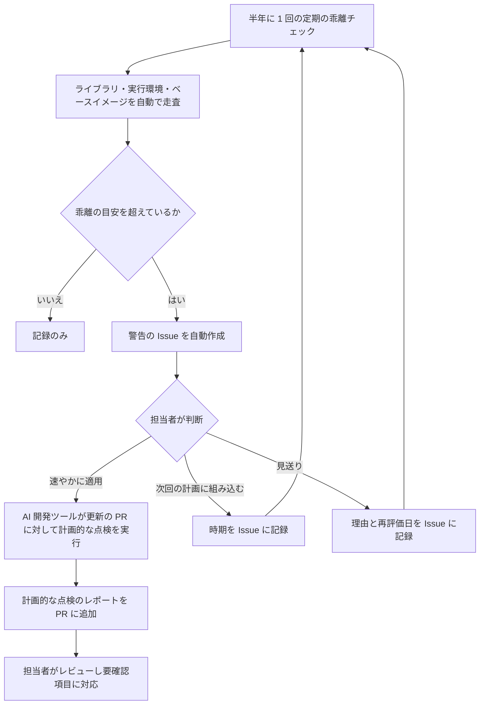

# 脆弱性パッチ適用時の無影響確認テスト ガイドライン

> 対象読者: 開発者（社員・ベンダー）とそのマネージャー
> 目的: 平時から不足するテストを充足し、至急対応を求められたときに、期限内に無影響確認を終えられる体制を整える
> ステータス: PoC / ドラフト

## 1. 目的・適用範囲・前提

### 1.1 目的

アプリを構成するソフトウェアに CVE（公開された脆弱性）が見つかると、提供元から緊急パッチが公開される。パッチを当てた後は、アプリの動作が変わっていないこと（**無影響確認**）を短時間で確かめなければならない。アプリによって、自動テストがほぼ網羅されているものから、まったくないものまである。

このガイドラインでは、以下3点を充足する事を目標とする。

- **至急対応** 緊急でのパッチ適用を求められたときに、不足するテストを至急で追加し、期限内に無影響確認を終えるための準備を整える。
- **平時の恒久準備** 各開発チームが、平時のうちに自らのアプリに足りないテストを把握し、前もって充足しておく。
- **計画的な点検** 初回の平時の恒久準備の後も、ライブラリや実行環境の新しいバージョン、深刻ではない脆弱性、静的コード解析の指摘など、アプリを取り巻く外界との差分は生まれ続ける。こうした差分を平時の対応の延長として修正し、修正後のアプリの無影響確認を続ける。

至急対応を期限内に終えられるかどうかは、平時の恒久準備でほぼ決まる。

### 1.2 適用範囲

| 項目 | 対象 |
|---|---|
| 言語 | Java・Python・TypeScript・C# |
| アプリの種類 | バックエンド・バッチ処理・Web フロントエンド・デスクトップアプリ |
| 更新の種類 | 至急対応：CVE が見つかったオープンソースのライブラリ、ミドルウェア、OS、実行環境 計画的な点検：ライブラリや実行環境の新しいバージョンへの更新、深刻ではない脆弱性の修正、静的コード解析の指摘への対応 |
| 対象とする作業 | パッチや修正を適用した後の無影響確認（テストの整備・実行と、結果の記録・判定）。本番リリースの手順は対象外とする |

### 1.3 前提

- **至急対応の要否。** 至急対応を行うかどうかは、脆弱性情報の収集を担う別のプロセスが判断する。このガイドラインでは判断しない。
- **期限。** 別のプロセスが至急対応の着手を求めた時点を起点とする。起点から、分析・方針決定・実装・テスト・ビルド・ステージング環境へのデプロイまでを **24 時間以内** に行う。本番への反映を含めた全体の期限は **48 時間** とする。24 時間のうち、テストの追加と実行に使えるのは 12 時間を目安とする。
- **CI。** すべてのチームで、GitHub Actions による CI/CD の整備を必須とする。workflow は、別に定めるガイドラインのものを使う。
- **スキル。** 無影響確認には、無影響確認テストのスキル（`patch-regression-test`）の利用を必須とする。スキルは、GitHub CopilotやDevin などの AI 開発ツールで実行する。このガイドラインは何を満たすべきかを定め、具体的な手順・テストの作り方・使うツールはスキルに定める。スキルは、アプリのソースコードの修正、アプリを動かすための環境設定（テストを動かすためのライブラリの導入を除く）、workflow の変更を一切行わない。
- **役割。**

  | 役割 | 担う内容 |
  |---|---|
  | 別のプロセス（脆弱性情報の収集を担うツール・人） | 至急対応の要否の判断と着手の依頼、脆弱性情報の Issue の作成 |
  | 開発チーム・担当者（社員、ベンダー） | パッチの適用とアプリの修正（別のツールを使ってよい）、スキルを使ったテストの整備・実行、レポートの作成 担当者は、計画的な点検のきっかけの Issue を受けた対応方針の判断、修正の PR と要確認項目のレビュー。開発チームのリーダーが指名する |
  | 開発チームのリーダー（社員） | 確認範囲の判定、想定どおりの差分の承認、PR の承認、担当者の指名、次長以上へのエスカレーション |
  | 次長以上 | 性能が不合格のときに、それでも本番リリースに踏み切るかの判断、期限の超過を認めるかの判断 |

  ベンダーが行った作業の判定と承認は、すべて社員が行う。

  システムの停止やネットワークからの遮断の判断は、別途定める意思決定フローで行う。開発チームは停止の判断を行わない。

### 1.4 ガイドラインの構成

このガイドラインは、**平時の対応**（「3章：平時の対応」）と **至急対応**（「4章：至急対応」）の 2 つに分かれる。どちらも、「2章：パッチの分類と確認の基準」の分類と確認の基準を使う。

| 章 | 内容 | 使う時期 |
|---|---|---|
| 2 | パッチの分類と確認の基準（確認範囲 0〜3、全確認範囲で共通のテスト、確認範囲別の追加テスト、判定のルール） | 平時・至急対応 |
| 3 | 平時の対応（平時の恒久準備と、その延長の計画的な点検） | 平時 |
| 4 | 至急対応 | 至急対応 |
| 5 | 確認観点チェックリスト | 平時・至急対応 |
| 6 | 性能劣化の判定基準 | 平時・至急対応 |
| 7 | 着手前に収集する情報 | 平時（計画的な点検時）・至急対応 |
| 8 | CI での実行と PR の判断基準 | 平時・至急対応 |
| 9 | 付録（参考文献） | ― |

### 1.5 用語

| 用語 | 意味 |
|---|---|
| 無影響確認 | パッチを当てた後も、アプリとしての動作が変わっていないことを確かめること |
| 平時の恒久準備 | CVE が公開される前に、不足しているテストと CI を整えておくこと。回数を強調する場合は「初回の平時の恒久準備」「2 回目以降」のように呼ぶ |
| 至急対応 | 別のプロセスが着手を求めた CVE について、期限内にパッチを適用し、無影響確認を行うこと |
| 計画的な点検 | 初回の平時の恒久準備の後、外界との差分（新しいバージョン、深刻ではない脆弱性、静的コード解析の指摘など）が見つかったときに、平時の対応の延長としてアプリを修正し、修正後のアプリの無影響確認を行うこと |
| 定期の乖離チェック | 半年に 1 回、使っているライブラリや実行環境が乖離の目安を超えていないかを調べること |
| 確認範囲 | 無影響確認に必要なテストの広さに応じた、パッチや更新の分類。至急対応と計画的な点検の両方で使う |
| 担当者 | 開発チームの中で、計画的な点検のきっかけの Issue を受けた対応方針の判断、修正の PR と要確認項目のレビューを担う人。開発チームのリーダーが指名する |
| 無影響確認テストのスキル | 不足しているテストの洗い出し・実装・実行と、レポートの出力を行う、AI 開発ツール向けの手順（`patch-regression-test`） |
| 静的コード解析 | プログラムを動かさずにソースコードを調べ、脆弱性や不具合のおそれがある書き方を見つけること |
| 機能テスト | パッチを当てる前の入出力を記録しておき、パッチを当てた後の入出力と比べるテスト。正しさではなく「変わっていないこと」を確かめる |
| 呼び出し箇所 | アプリのソースコードの中で、更新対象のライブラリを呼んでいる箇所 |
| 不安定なテスト | flaky テストとも呼ぶ。コードを変えていないのに、実行するたびに成功したり失敗したりするテスト |
| SBOM | ソフトウェアの部品表。アプリが使っているライブラリとそのバージョンの一覧 |
| SCA | ソフトウェア構成分析。依存しているライブラリに既知の脆弱性がないかを調べるスキャン |
| 暫定合格 | 基準を満たさないが、定められた判断によりリリースを許可すること。後日の調査・改善を前提とする |
| シグネチャ | メソッドや関数の名前、引数の数・型・順序、戻り値の型など、呼び出し方を決める情報 |
| 破壊的変更 | シグネチャの変更など、アプリのソースコードを直さないと動かなくなる変更 |
| 間接依存 | アプリが直接使っているライブラリが、さらに使っているライブラリ |
| lock ファイル | 間接依存も含めて、実際に使うライブラリのバージョンを固定したファイル（`package-lock.json`・`poetry.lock`・`packages.lock.json` など） |
| LTS | Long Term Support。提供元が長期間のサポートを約束している版の系列 |
| CVSS | 脆弱性の深刻度を 0.0〜10.0 で表す共通の評価基準 |
| スモークテスト | 起動や主要な入口が応答するかだけを短時間で確かめる、最小限のテスト |
| 結合テスト | 複数の部品を組み合わせて、業務の流れが正しく動くかを確かめるテスト |
| 契約テスト | 外部のシステムとのやりとり（API・ファイル・DB の構造）の形が守られているかを確かめるテスト |
| E2E テスト | 画面の操作から処理の結果までを、利用者と同じ経路で通して確かめるテスト |

## 2. パッチの分類と確認の基準

パッチや更新は、無影響確認に必要なテストの広さに応じて **確認範囲 0〜3** に分類する。確認範囲が大きいほど、追加するテストが増える。至急対応と、計画的な点検の依存の更新・脆弱性の修正で、同じ分類を使う。この章では、分類に加えて、どの場面でも使う確認の内容と判定のルールを定める。

### 2.1 確認範囲の定義

| 確認範囲 | 定義 | 例 |
|---|---|---|
| 0 | ライブラリの更新で、シグネチャの変更がなく、振る舞いの変更もない（リリースノートに書かれておらず、更新前後の差分からも見つからない。脆弱性の修正そのものによる変化は除く） | 脆弱性の修正だけを含むパッチリリース |
| 1 | ライブラリの更新で、シグネチャの変更はないが、振る舞いの変更（デフォルト設定・入力検証・出力形式など）がある（リリースノートに書かれている、または更新前後の差分から見つかった） | 安全のためにデフォルト設定が厳しくなったパッチ |
| 2 | ライブラリの更新で、シグネチャの変更（破壊的変更）があり、アプリのソースコードの修正が必要 | メソッドの削除・引数の変更を含むバージョンアップ |
| 3 | 実行環境・OS・ミドルウェアの更新、フレームワークの系列の更新、新しい実行環境を必要とするライブラリの更新 | JDK・Python・Node.js・.NET の更新、OS・コンテナのベースイメージの更新、DB の更新、Spring Boot 2 → 3 |

#### 2.1.1 変化を確かめられない場合

確認範囲 0〜2 は、リリースノートや更新前後の差分で、どんな変化があるかを確かめて決める。複数の版をまたぐ更新などで、版ごとに確かめられない場合は、代わりに **バージョンの上がり方** で決める。

| バージョンの上がり方 | 確認範囲 | 例 |
|---|---|---|
| 同じメジャー版の中での更新（パッチ・マイナー） | 1 | ライブラリの 2.3 → 2.7 |
| メジャー版が上がる更新 | 2 | ライブラリの 2.x → 4.x |

- 変化がないことを確かめられないため、確認範囲 0 にはしない。
- 同じメジャー版の中での更新でも、ビルドなどでシグネチャの変更が見つかった場合は、確認範囲 2 とする。
- 確認範囲 3 にあたる更新は、バージョンの上がり方にかかわらず確認範囲 3 とする。

### 2.2 判定の手順

確認範囲は **開発チームのリーダー** が判定し、判定した確認範囲と理由をレポートに記録する。判定の根拠には、リリースノート、更新前後の差分、移行ガイドなどを使う。

### 2.3 判定の注意点

- **複数の更新を同時に行う場合** は、その中で最も大きい確認範囲に合わせる。
- **間接依存のライブラリのバージョンも変わる場合** は、変わる間接依存も更新の対象として判定し、最も大きい確認範囲に合わせる。
- **コンテナのベースイメージの更新** は、OS の更新として確認範囲 3 で扱う。
- **フレームワーク（Spring Boot・Django・React・ASP.NET Core など）の系列の更新** は、至急対応を含めて確認範囲 3 で扱う。
- **シグネチャの変更の確かめ方は、言語によって異なる。** コンパイルで見つかる言語と、実行するまで気づけない言語がある。スキルに定める手順で確かめる。

### 2.4 全確認範囲で共通のテスト

どの確認範囲でも、次の確認を行う。計画的な点検では、「パッチ前後」を「修正前後」と読み替える。

| チェック内容 | 項目 | 行う条件 | 合格条件 |
|---|---|---|---|
| C1 | ビルド・静的解析 | いつも行う | エラーなし。依存ツリーをパッチ前後で比較し、意図しない更新がない |
| C2 | 起動スモークテスト | いつも行う | アプリが起動し、主要な入口（API・画面・バッチ起動）が応答する |
| C3 | 既存の自動テストの全件実行 | いつも行う | 不安定なテストの一覧にあるものを除き、すべて成功する |
| C4 | 脆弱性スキャン（SCA）の再実行 | いつも行う | 修正の対象が脆弱性のときは、対象の脆弱性が検出されなくなっている。それ以外のときは、パッチ前より検出数が増えていない |
| C5 | 脆弱性の修正確認テスト | 修正の対象が脆弱性のとき（公開情報から問題になる入力を作れる場合） | 問題になる入力が拒否される |
| C6 | 性能 | いつも行う（性能テストを選択的に外した場合は対象外とし、残存リスクとして記録する） | 性能劣化の判定基準のしきい値の範囲内である |
| C7 | 静的コード解析のやり直し | 静的コード解析の指摘に対応したソースコードの修正のとき | 対象の指摘が出なくなっている |

- **外部で修正されたソースコード。** きっかけ（脆弱性の検知、ライブラリの更新、静的コード解析の指摘など）を問わず、パッチや更新に伴ってアプリのソースコードが修正された場合は、修正した箇所と、その箇所を呼び出している処理をテストの対象にする。

### 2.5 確認範囲別の追加テスト

確認範囲に応じて、全確認範囲で共通のテストに加えて次のテストを行う。

| 確認範囲 | 全確認範囲で共通のテストに加えて行うこと |
|---|---|
| 0 | 更新対象の **呼び出し箇所** を洗い出し、そこを通るテストがあることを確認する。なければ追加する |
| 1 | 確認範囲 0 に加えて、呼び出し箇所に **機能テスト** を置く。パッチ前の入出力を記録し、パッチ後と比べる |
| 2 | 確認範囲 1 に加えて、次を行う ・変更された API について **ライブラリ側の挙動の違い** を分析し、アプリとしては同じ入力に同じ結果を返すことを確かめるテストを書く ・移行ガイドをメジャー版ごとに読んで **破壊的変更の一覧** を作り、一覧にある箇所を通るテストを書く ・主要業務フローの結合テスト ・契約テスト・E2E スモークテスト ・ステージング環境での確認 |
| 3 | 確認範囲 2 に加えて、**確認範囲 3 向けの環境確認**（配布物の作成、TLS と証明書、ロケールとタイムゾーン、文字コード、ファイル入出力、ミドルウェア）を行う |

- **破壊的変更の一覧** は、メジャー版ごとに分けて書く。差分が出たときに、どの版の変更によるものかを切り分けるためである。
- **契約テスト・E2E スモークテスト** は、どの場面でも、アプリ固有の事情に応じて選択的に外してよい。
- **ステージング環境での確認** は、開発チームが行う。

### 2.6 判定のルール

- **想定どおりの差分。** パッチや更新によって意図的に変わった挙動（リリースノートなどに書かれているもの。例: 悪意のある入力を拒否するようになった）は、理由を記録し、**開発チームのリーダー** の承認を受ける。脆弱性の修正そのものによる変化だけでなく、同じパッチや更新に含まれるほかの変更による変化も含む。承認のない差分が 1 つでもあれば不合格とする。
- **パッチ前後での同一テストの実行。** 同じテストをパッチ前とパッチ後の両方のバージョンで実行し、結果を比べる。
- **非決定的な出力。** 時刻・乱数・ID など実行のたびに変わる値は、比較の前に伏せる。不安定なテストは事前に一覧にしておき、合否の判定から外す。
- **除外したテストレベル。** 選択的に外したテストレベル（E2E・契約テスト・性能テストなど）は、残存リスクとしてレポートに記載する。
- **対象がないテスト。** アプリにもともと対象がないテスト（例: 画面がないので E2E スモークテストの対象がない）は、「外した」ではなく「該当なし（理由）」と記録する。
- **不合格と判断待ち。** **不合格** とするのは、テストを実施した結果、期待どおりの結果が得られなかった場合と、しきい値を満たさなかった場合に限る。CI やチームに任せた確認（ステージング環境での確認、CI に組み込まれていない環境確認など）が残る場合は、**判断待ち** とする。

## 3. 平時の対応

この章では、平時に行うことを定める。前半は、CVE が公開される **前に** 整えておく平時の恒久準備である。後半は、その延長として行う計画的な点検である。至急対応を期限内に終えられるかどうかは、平時の恒久準備でほぼ決まる。

### 3.1 最小限の自動テストの整備

#### 3.1.1 準備レベル

各チームは自分のアプリがどの準備レベルにあるかを判定し、不足している項目を把握する。全チームの当面の目標は **L2**、最終目標は **L3** とする。

L1 は L1 の項目が、L2 は L1 と L2 の項目が、L3 はすべての項目が CI で動いている状態をいう。L1 に届かない状態を L0 とする。

| 準備レベル | 準備内容 | 項目 | 内容 |
|---|---|---|---|
| **L1** | P1 | 依存ライブラリの一覧（SBOM） | 別の手順で生成されている SBOM（ソフトウェアの部品表）を、ビルドのたびに参照する |
| | P2 | 脆弱性スキャン | 依存ライブラリの脆弱性スキャン（SCA）を CI で実行する |
| | P3 | 起動スモークテスト | アプリを起動し、主要な入口（API・画面・バッチ起動）が応答することを確かめる |
| **L2** | P4 | 呼び出し箇所一覧 | アプリが外部ライブラリを呼んでいる箇所の一覧を作り、ソースコードの変更に合わせて更新する |
| | P5 | 呼び出し箇所の機能テスト | P4 の呼び出し箇所ごとに、入出力を記録して比較する機能テストを用意する |
| | P6 | 主要業務フローの結合テスト | アプリの主要な業務の流れを確かめる結合テストを 3〜5 本用意する |
| | P7 | パッチ前後の比較 | 同じテストをパッチ前後の両方のバージョンで実行し、結果を比べられる CI を用意する。workflow は、別に定めるガイドラインのものを使う |
| **L3** | P8 | 外部連携の契約テスト | 外部とのやりとり（API・ファイル・DB の構造）の形が守られていることを確かめる。選択的に外してよい |
| | P9 | E2E スモークテスト | Web 画面・デスクトップ画面を実際に操作する最小限のテスト。選択的に外してよい |
| | P10 | 確認範囲 3 向け環境確認 | 実行環境・OS・ミドルウェアの更新に備えた環境確認を CI で実行する（「3.3：確認範囲 3 向け環境確認の CI 自動化」） |
| | P11 | 性能ベースラインと不安定なテストの管理 | 性能ベースラインを計測し、不安定なテストを一覧にしておく（「3.4：性能ベースライン計測と不安定なテストの洗い出し」）。性能テストは選択的に外してよい |

選択的に外した項目は、その理由とともにレポートに残存リスクとして記録する。理由を記録して外した項目は、準備レベルの判定では満たしたものとみなす。

L2 は当面の目標だが、確認範囲 3 の至急対応には P10 が必要である。P10 がない状態で確認範囲 3 の至急対応を求められた場合は、L2 であってもエスカレーションが必要になる。

準備が足りず、期限（「1.3：前提」）内に対応を終えられない見込みの場合でも、対応は免れない。開発チームのリーダーは直ちに次長以上にエスカレーションしたうえで、対応を続ける。エスカレーションの内容は、別途進めている現状の可視化の枠組みで報告する。

#### 3.1.2 アプリ種別ごとの重点

| アプリ種別 | P3 起動スモークの入口 | P6 主要業務フローの例 | P8・P9 の観点 |
|---|---|---|---|
| バックエンド | ヘルスチェック API・主要 API | 認証 → 主要な更新処理 → 参照 | API の契約テスト |
| バッチ処理 | 小さな入力データでのジョブ起動 | 入力ファイル → 変換 → 出力・DB 更新 | 入出力ファイルの形式 |
| Web フロントエンド | トップ画面の表示 | ログイン → 主要な画面操作 | ブラウザでの E2E スモーク |
| デスクトップアプリ | アプリの起動と初期画面 | 主要な画面操作 | 画面操作の E2E スモーク・インストーラーの作成 |

### 3.2 LTS 版とのバージョン乖離の解消

バージョンの乖離が大きいほど、CVE が出たときのパッチは破壊的変更を含みやすくなり、確認範囲 2 以上になる可能性が高まる。**定期的に更新して乖離をためない** ことが、至急対応を短くする最も効果的な準備である。

#### 3.2.1 乖離の目安

| 対象 | 目安 |
|---|---|
| 実行環境（JDK・Python・Node.js・.NET） | 提供元のサポート期間内の系列を使う。LTS がある場合は LTS 系列に乗せる。サポート終了の 6 か月前までに次の系列への移行計画を立てる |
| フレームワーク（Spring Boot・Django・React・ASP.NET Core など） | 提供元のサポート期間内の系列を使う |
| ライブラリのパッチ・マイナー更新 | 最新リリースから 1 年以上遅れない |
| ライブラリのメジャー更新 | 最新から 1 メジャー以内。メジャー更新は計画を立てて別に進める |
| OS・コンテナのベースイメージ | 提供元のサポート期間内のものを使い、半年に 1 回は最新のイメージで作り直す |
| 更新が止まったライブラリ | 1 年以上リリースがないもの、サポートが終了したものは代替を検討する |

これらは目安であり、アプリの事情に応じて調整してよい。調整した場合は理由を記録する。

#### 3.2.2 定期の乖離チェックの流れ

1. **走査。** 半年に 1 回、使っているライブラリの新しい版と、実行環境・フレームワーク・ベースイメージのサポート終了日を、Dependabot のバージョン更新と GitHub Actions の定期の workflow で自動的に走査する。
2. **警告。** 乖離の目安を超えているものがあれば、警告の Issue を自動で作る。Issue のタイトルには「定期の乖離チェック」と更新対象の名前を入れる（例: `[定期の乖離チェック] xxx ライブラリ`）。
3. **判断。** 担当者が Issue を見て、「速やかに適用」「次回の計画に組み込む」「見送り」のいずれかを決め、Issue に記録する。見送る場合は理由と再評価日を必ず書く。
4. **適用。** 「速やかに適用」と決めた更新は、計画的な点検の依存の更新として確認する。AI 開発ツールが、更新の PR（例: Dependabot のバージョン更新の PR）に対して、無影響確認テストのスキルを対話なしで実行してよい。

#### 3.2.3 Dependabot の 2 つの機能

Dependabot には、性質の違う 2 つの機能がある。このガイドラインでは、両方を使う。

| 機能 | 何をするか | いつ動くか | このガイドラインでの使い方 |
|---|---|---|---|
| **セキュリティ更新** | 使っているライブラリに脆弱性が見つかったとき、直った版へ更新する PR を自動で作る | 脆弱性が公表されたとき | 別のプロセスから至急対応を求められた場合は、この PR を至急対応に使う。至急対応を求められない深刻ではない脆弱性は、計画的な点検の脆弱性の修正として扱う。定期の乖離チェックとは別に、常に有効にしておく |
| **バージョン更新** | 脆弱性がなくても、ライブラリを新しい版へ更新する PR を定期的に作る | 決めた間隔ごと（このガイドラインでは半年に 1 回） | 定期の乖離チェックの走査に使う |

### 3.3 確認範囲 3 向け環境確認の CI 自動化

実行環境・OS・ミドルウェアの更新（確認範囲 3）は、準備がなければ、至急対応の際にシステムの停止を伴うおそれがある。次の確認を CI で自動実行できる状態にしておく。

| 確認内容 | 例 |
|---|---|
| 配布物の作成 | コンテナイメージ・インストーラーが作れる |
| TLS と証明書 | 外部接続で TLS のハンドシェイクが成功する。社内 CA の証明書が読み込まれる |
| ロケールとタイムゾーン | 日付・数値の書式、タイムゾーンの変換が変わらない |
| 文字コード | ファイルや標準入出力の既定の文字コードが変わらない |
| ファイル入出力 | パス・改行コード・権限の扱いが変わらない |
| ミドルウェア | DB・メッセージキューなどをバージョンを指定してテスト用に起動し、接続と主要な操作ができる |
| OS 更新の予行練習 | ベースイメージを最新にして CI を通す（「3.2.1：乖離の目安」の半年に 1 回の作り直しと兼ねる） |

デスクトップアプリのインストーラー作成など、CI で動かす方法がアプリによって大きく異なるものは、各チームの判断で実装する。

### 3.4 性能ベースライン計測と不安定なテストの洗い出し

- **性能ベースライン。** 性能劣化の判定に使う指標を、少なくとも半年に 1 回（定期の乖離チェックと同時に）計測し、CI の成果物として保存する。長期的な傾向を見るために使う。
- **不安定なテスト。** 不安定なテストの原因には、時刻や乱数への依存、テスト同士の実行順序への依存、外部サービスの応答の揺れなどがある。至急対応の最中に不安定なテストが失敗すると、パッチの影響なのかどうかを判断できない。そのため、平時に同じテストを複数回実行して不安定なテストを見つけ、一覧にしておく。一覧にあるテストは、原因を直すまで合否の判定から外す。
- **非決定的な値の扱い。** 時刻・乱数・ID など実行のたびに変わる値を比較の前に伏せる方法を、テストごとに事前に決めておく。
- **予行演習。** 模擬の CVE を使って、着手の依頼からステージングへのデプロイまでを 24 時間以内に行う訓練を、定期的に実施することが望ましい。

### 3.5 平時の継続的な点検（計画的な点検）

初回の平時の恒久準備が済んだ後も、アプリを取り巻く外界は変わり続ける。その差分が見つかったときに、**平時の対応の延長として** アプリを修正し、修正後のアプリの無影響確認を行うことを「計画的な点検」と呼ぶ。

- **役割の分担。** アプリの修正（ライブラリの更新、脆弱性の修正、ソースコードの修正）は、別のツール（Dependabot・Devin など）や人が行う。開発チームは、無影響確認テストのスキルを使って、修正後のアプリのテストを行う。
- **前提。** 初回の平時の恒久準備が済んでいることを前提とする。CI に足りないものが見つかった場合は、平時の恒久準備として整える。
- **期限。** 至急対応ではないので、期限はない。ただし、修正を適用する時期をきっかけの Issue に記録する。

#### 3.5.1 点検のきっかけと種類

| 点検の種類 | きっかけ | 例 |
|---|---|---|
| **依存の更新** | 使っているライブラリや実行環境の新しいバージョンが出た | 定期の乖離チェックの警告、Dependabot のバージョン更新の PR |
| **脆弱性の修正** | 至急対応を必要としない、深刻ではない脆弱性が見つかった | 別のプロセスが至急対応の対象としなかった CVE、Dependabot のセキュリティ更新の PR |
| **ソースコードの修正** | 静的コード解析で、修正すべき問題（脆弱性を含む）が見つかった | 静的コード解析ツールの指摘 |

1 つの PR に複数の種類が含まれる場合は、それぞれの種類の確認を行う。

#### 3.5.2 種類ごとの確認の対象

- **依存の更新・脆弱性の修正。** 至急対応と同じく、「2章：パッチの分類と確認の基準」の確認範囲 0〜3 に分ける。依存の更新は複数の版をまたぐことが多いため、多くの場合は「2.1.1：変化を確かめられない場合」のとおり、バージョンの上がり方で決まる。
- **ソースコードの修正。** 確認範囲は使わない。

確認範囲の判定と差分の承認は、開発チームのリーダーが行う。

#### 3.5.3 確かめることと合格の条件

至急対応と同じく、「2.4：全確認範囲で共通のテスト」と「2.5：確認範囲別の追加テスト」に従い、「2.6：判定のルール」で判定する。

#### 3.5.4 判定の考え方

1. **大きな更新も 1 つの PR のままでよい。** メジャー版を 2 つ以上またぐ更新でも PR は分けない。破壊的変更の一覧をメジャー版ごとに分けて書くことで、差分の原因となった版を切り分ける。
2. **暫定合格は使わない。** 急ぐ理由がないため、基準を満たすまでマージしない。性能の暫定合格も適用しない。判断待ちの項目が残っても、期限がないため、次長以上へのエスカレーションは行わない。
3. **必須の情報が欠けたとき。** 欠けた情報を残存リスクとしてレポートに記録する。
4. **対話なしでの実行。** 計画的な点検は、どの種類でも、AI 開発ツールが修正の PR に対して無影響確認テストのスキルを対話なしで実行してよい。至急対応と平時の恒久準備は、必ず対話で実行する。対話で実行していれば人に確認して決めていた事項は、レポートの要確認項目に記載される。担当者は、PR のレビューでこの項目に対応する。

## 4. 至急対応

別のプロセスから至急対応の着手を求められた後に、無影響確認を期限内に終えるための原則と、確認範囲 3 を扱う場合の手順を定める。確かめることと合格の条件は「2.4：全確認範囲で共通のテスト」と「2.5：確認範囲別の追加テスト」に、判定は「2.6：判定のルール」に従う。平時の恒久準備（「3章：平時の対応」）が整っていることを前提とする。

### 4.1 基本原則

1. **バージョン番号を信用しない。** パッチリリースでも破壊的変更は珍しくない（Maven では、パッチリリースの約 4 分の 1、マイナーリリースの 3 分の 1 強に破壊的変更があったという報告がある）。シグネチャが変わらなくても、振る舞いは確認する。
2. **迷ったら広く確かめる。** 影響範囲を特定しきれない場合は、テストを絞らない。変化を確かめられない場合は、「2.1.1：変化を確かめられない場合」のとおり確認範囲を決める。
3. **行カバレッジより呼び出し箇所。** 守るべきは「アプリが更新対象を使っている箇所」である。カバレッジの数値が高くても、呼び出し箇所を通るテストがなければ不足とみなす。
4. **時間の上限を守る。** 着手の依頼からステージングへのデプロイまでの 24 時間のうち、テストの追加と実行に使えるのは **12 時間** を目安とする。

### 4.2 確認範囲 3 を至急対応で扱う場合

確認範囲 3 の環境確認は、本来「3.3：確認範囲 3 向け環境確認の CI 自動化」の平時の恒久準備として CI に組み込んでおくものである。

その準備がないまま、やむを得ず至急対応で確認範囲 3 を扱う場合は、次の手順を取る。

1. 開発チームのリーダーは、直ちに次長以上にエスカレーションする。対象システムを **停止またはネットワークから遮断** するかどうかは、別途定める意思決定フローで判断される。開発チームは停止の判断を行わない。
2. 「3.3：確認範囲 3 向け環境確認の CI 自動化」の環境確認を **平時の恒久準備と同じ水準で** 実施する。着手の依頼からステージングへのデプロイまでの 24 時間（本番反映を含めた全体の期限は 48 時間）を超えるおそれがある場合でも、開発チームの判断で確認を省略したり、期限の超過を決めたりしてはならない。期限の超過を認めるかどうかは、エスカレーションを受けた次長以上が判断する。
3. 脆弱性の除去と無影響が確認できたら、その結果を報告する。システムを停止・遮断していた場合、稼働の再開は意思決定フローに従う。

システムを停止・遮断した場合、その時間がそのままビジネス上の損失になる。**停止時間を短くする唯一の手段は、平時に「3.3：確認範囲 3 向け環境確認の CI 自動化」を整えておくことである。**

## 5. 確認観点チェックリスト

シグネチャが変わらなくても、振る舞いは変わることがある。とくに脆弱性の修正では、安全側に倒した変更が既存の動作に影響しやすい。無影響確認では、次の観点を確認範囲に応じて確認する。「対象の確認範囲」が「全確認範囲」の観点は、確認範囲 0 でも確認する。

| 確認観点 | 項目 | 起きやすい変化の例 | 対象の確認範囲 |
|---|---|---|---|
| V1 | 起動とデプロイ | 起動しない、設定ファイルを読めない、配布物が作れない | 全確認範囲 |
| V2 | 間接依存の変化 | パッチに伴い、別のライブラリのバージョンも変わる | 全確認範囲 |
| V3 | 脆弱性の修正 | 修正が効いていない | 修正の対象が脆弱性のとき |
| V4 | デフォルト設定の変更 | TLS のバージョン、デシリアライズの許可リスト、XML の外部実体参照（XXE）、Cookie の属性の既定値が厳しくなる | 確認範囲 1 以上 |
| V5 | 入力検証の厳格化 | 以前は受け付けていた不正な形式・文字コード・パスが拒否される | 確認範囲 1 以上 |
| V6 | 出力形式の変化 | JSON・XML・日付・数値・null の表現、項目の順序が変わる | 確認範囲 1 以上 |
| V7 | 例外とエラーの変化 | 例外の型、エラーメッセージ、エラーコードが変わり、呼び出し側のエラー処理が想定どおりに動かない | 確認範囲 1 以上 |
| V8 | ログと監視 | ログの形式が変わり、ログを使った監視・監査が動かない | 確認範囲 1 以上 |
| V9 | 並行処理とリソース | スレッドの扱い、接続プール、メモリ使用量が変わる | 高い性能が求められるシステムのみ（該当するかは開発チームのリーダーが判断する） |
| V10 | 破壊的変更への対応 | 破壊的変更に合わせて外部で修正されたソースコードで、アプリとしての結果が変わる | 確認範囲 2 以上 |
| V11 | 実行環境・OS に固有の変化 | 証明書ストア、ロケール・タイムゾーンのデータ、既定の文字コード、ファイル操作の挙動が変わる | 確認範囲 3 |

### 5.1 V4 デフォルト設定の変更の例

ライブラリの提供元は、脆弱性を直すために、**何も設定していないときの動き（既定値）を安全な側に変える** ことがある。この場合、アプリのソースコードを 1 行も変えていなくても、パッチを当てただけで、今まで通っていた処理が失敗するようになる。

| 例 | 変わる前 | 変わった後 | アプリで起きること |
|---|---|---|---|
| TLS のバージョン | 古い TLS 1.0・1.1 でも接続できた | TLS 1.2 以上でないと接続を断る | 古い社内サーバーへの接続が、急に失敗する |
| デシリアライズの許可リスト | 保存データからどのクラスでも復元できた | 許可したクラスしか復元しない | 保存済みのセッションやデータが読み込めなくなる |
| XML の外部実体参照（XXE） | XML の中から外部ファイルを参照できた | 既定で参照を禁止する | 外部参照を使う XML の取り込みでエラーになる |
| Cookie の属性 | `SameSite` の指定がなかった | 既定で `SameSite=Lax` が付く | 別のドメインから戻ってくる SSO のログインが通らなくなる |

社内向けのアプリでは、古い社内サーバーとの接続（TLS）や、社内の SSO（Cookie）で起きやすい。呼び出し箇所の機能テストで、こうした入力や接続先を使うケースを用意しておく。

どの観点でも、差分が見つかった場合は「2.6：判定のルール」のとおり扱う。

## 6. 性能劣化の判定基準

パッチの適用によって性能が著しく劣化していないかを判定する基準を定める。業界で決まった標準値はないため、ここでは **初期値** を示す。アプリの事情に応じて調整してよいが、調整した場合は理由を記録する。

### 6.1 測る指標

| アプリ種別 | 指標 |
|---|---|
| バックエンド | 応答時間の 95 パーセンタイル（p95）、スループット（一定時間に処理できる件数） |
| バッチ処理 | 処理時間 |
| Web フロントエンド | 画面が表示されるまでの時間 |
| デスクトップアプリ | 全種別共通の指標のみ |
| 全種別共通 | 起動時間、メモリ使用量の最大値 |

p95 とは、すべてのリクエストを速い順に並べたときに 95% 目にあたる応答時間のことである。平均よりも、一部の遅いリクエストの悪化に気づきやすい。

### 6.2 しきい値（初期値）

| 判定 | 条件 |
|---|---|
| 合格 | 劣化が +10% 未満 |
| 警告 | 劣化が +10% 以上 +30% 未満。レポートに記載する |
| 不合格 | 劣化が +30% 以上 |
| 要確認 | 30% 以上 **良く** なった。処理が飛ばされていないかを調べ、問題がなければ合格とする |

- **劣化の向き。** 応答時間・処理時間・起動時間・画面表示時間・メモリ使用量は、値が **増えたら** 劣化とする。スループットは、値が **減ったら** 劣化とする。劣化の割合は「パッチ後とパッチ前の差 ÷ パッチ前の値」で計算する。
- **絶対値の下限。** パッチ前後の **差** がごく小さいものは、割合が大きくても劣化とみなさない。初期値は、応答時間の差が 1 秒未満、バッチの処理時間の差が 5 分未満とする。下限のために劣化とみなさなかった項目は、劣化の割合と差をレポートの「後で対応すること」に記録し、後日の解消課題とする。
- **不合格のときの扱い。** 不合格の項目がある場合は、開発チームのリーダーが内容を確認し、次長以上にエスカレーションする。次長以上が業務上許容できると判断した場合は **暫定合格** とする。その場合は、判断の理由と劣化の値をレポートに残存リスクとして記録する。ただし、「6.3：測り方」のバッチが処理時間枠に収まった場合の暫定合格は、次長以上の判断を要しない。暫定合格は至急対応に限って使い、計画的な点検では使わない。

### 6.3 測り方

- **パッチ前後を続けて測る。** 同じ CI の実行の中で、パッチ前とパッチ後を続けて測る。過去に保存したベースライン（「3.4：性能ベースライン計測と不安定なテストの洗い出し」）だけと比べると、マシンの差が結果に混ざるためである。保存したベースラインは、長期的な傾向を見るために使う。
- **画面とサービス（バックエンド・Web フロントエンド・デスクトップアプリ）は、繰り返して中央値をとる。** 繰り返す回数や準備運転のしかたは、スキルに定める。
- **バッチ処理は、制限時間内に収まるかで判定する。** 長時間かかるバッチもあるため、繰り返し測ることを前提にしない。制限時間は、「6.2：しきい値（初期値）」の不合格のしきい値（パッチ前の処理時間の +30%。ただし差が 5 分未満なら劣化とみなさない）とする。
  1. 1 回目の実行が制限時間内に収まれば **合格** とする。
  2. 収まらなかった場合は再実行し、最大 3 回まで実施する。いずれかの回で収まれば **合格** とする。
  3. 3 回とも収まらなかった場合は、処理時間が **運用上決められたバッチの処理時間枠**（例: 夜間の 2 時〜5 時に終わること）に収まっているかを追加で確認する。
     - 処理時間枠に収まっている場合は **暫定合格** とし、リリースを許可する。ただし、後日あらためて性能劣化の原因を調査し、早急に性能の改善を図る。暫定合格とした理由と、調査・改善の予定をレポートに記録する。
     - 処理時間枠に収まらない場合は **不合格** とし、「6.2：しきい値（初期値）」の「不合格のときの扱い」に従う。
- 性能テストは選択的に外してよい（「3.1.1：準備レベル」）。外した場合は、「2.6：判定のルール」のとおり残存リスクとしてレポートに記載する。

## 7. 着手前に収集する情報

分析やテストの実装を始める前に、次の情報をそろえる。

**必須** の情報が欠けている場合の扱いは、次のとおりとする。

- **至急対応。** 欠けている情報をレポートに明記し、その場で開発チームのリーダーの判断を待つ。
- **計画的な点検。** 欠けている情報を残存リスクとしてレポートに記録し、作業を進める。

| 情報分類 | 項目 | 情報の種類 | 区分 | 使い道 |
|---|---|---|---|---|
| I1 | 脆弱性 | CVE 番号 | 必須 | 対象の特定 |
| I2 | 脆弱性 | 脆弱性情報（NVD・GHSA など）、CVSS、影響を受ける関数や機能 | 必須 | 修正確認テストの作成（C5） |
| I3 | 変更内容 | 更新対象と、更新前後のバージョン | 必須 | 確認範囲の判定（「2章：パッチの分類と確認の基準」） |
| I4 | 変更内容 | リリースノート、変更履歴、移行ガイド | 必須 | 破壊的変更・振る舞いの変更の有無の判断 |
| I5 | 変更内容 | 更新前後のソースの差分 | 確認範囲 1 以上で推奨 | リリースノートに書かれていない振る舞いの変更の発見 |
| I6 | 依存関係 | lock ファイル、依存ツリー、一緒に更新される間接依存 | 必須 | 影響範囲の把握（V2）、間接依存も含めた確認範囲の判定 |
| I7 | 対象アプリ | リポジトリ、言語、アプリ種別、外部との接続先（DB・API・ファイル） | 必須 | テストの設計とツールの選択 |
| I8 | 現在のテスト | テストコード、GitHub Actions の workflow、準備レベル（「3.1.1：準備レベル」） | 必須 | 不足しているテストの洗い出し |
| I8a | 現在のテスト | カバレッジのレポート | 任意（あるほうが望ましい） | 不足しているテストの洗い出しの補助 |
| I9 | 性能 | 性能ベースライン（「3.4：性能ベースライン計測と不安定なテストの洗い出し」） | 任意 | 長期的な傾向との比較 |
| I10 | 実行条件 | 選択的に外すテストレベルとその理由 | 任意 | 作業範囲の決定、残存リスクの記録（「2.6：判定のルール」） |
| I11 | 実行条件 | ステージング環境の有無と接続方法 | 確認範囲 2・3 では必須 | ステージング環境での確認、E2E スモークテストの実施可否 |
| I12 | 実行条件 | 至急対応の着手の依頼時刻と期限（24 時間・48 時間） | 至急対応では必須 | 作業の時間配分 |
| I13 | 体制 | 確認範囲の判定と差分の承認を行う開発チームのリーダー、エスカレーション先の次長以上 | 必須 | 判定と承認の依頼先 |
| I14 | 静的コード解析 | 静的コード解析の結果（ツール名、指摘の内容と識別子、対象のファイルと行） | 計画的な点検のソースコードの修正では必須 | 修正した箇所と、テストの対象の特定 |

計画的な点検（「3.5：平時の継続的な点検（計画的な点検）」）では、点検の種類に応じて次の情報を使う。I12（着手の依頼時刻と期限）は、期限がないため使わない。

| 点検の種類 | 使う情報 |
|---|---|
| 依存の更新 | I3〜I11・I13 |
| 脆弱性の修正 | I1〜I11・I13 |
| ソースコードの修正 | I5〜I11・I13・I14（I5 は修正の PR の差分） |

### 7.1 脆弱性情報とパッチの変更内容の置き場所

Issue や PR は、Dependabot・Devin などのツールや人が作る。

- **脆弱性情報（I1・I2）。** 脆弱性情報の収集を担うツール・人が、対象アプリのリポジトリの **GitHub Issue** に記載する。
  - Issue のタイトルには、必ず CVE 番号を含める（例: `[CVE-2026-12345] xxx ライブラリの脆弱性対応`）。無影響確認を行う人やツールは、CVE 番号でこの Issue を探す。
  - 1 つの Issue で複数の CVE をまとめて扱う場合は、タイトルにすべての CVE 番号を含める。
- **静的コード解析の結果（I14）。** 静的コード解析を担うツール・人が、対象アプリのリポジトリの **GitHub Issue** に記載する。Issue のタイトルには「静的コード解析」と、ツール名・指摘の識別子を入れる（例: `[静的コード解析] xxx ツール yyy-123`）。
- **パッチの変更内容（I4・I5）。** パッチの適用を担うツール（Dependabot など）が作る **PR の説明文** に記載されたものを使う。Dependabot の PR には、通常、リリースノートや変更履歴の抜粋と、更新前後の比較へのリンクが載る。説明文に足りないものがあれば、PR を作ったツール・人が追記する。
- Issue や PR の説明文に情報が見つからない場合は、無影響確認を行う人に情報を直接渡す。

収集した情報と、その入手元は、無影響確認テスト実施レポートの冒頭に記録する。

## 8. CI での実行と PR の判断基準

無影響確認の結果を PR のマージの判断に使うために、CI と PR に求めることを定める。workflow の実装は、別に定めるガイドラインに従う。ステージング環境へのデプロイは、各チームの既存の CD に任せる。

### 8.1 CI で実行されている必要があるもの

- **実行のきっかけ。** パッチや修正を含む PR で実行される。依存関係のファイルを変更しない PR（実行環境・OS・ミドルウェアの更新、ソースコードの修正など）でも実行できる。
- **確認の内容。** 「2.4：全確認範囲で共通のテスト」と「2.5：確認範囲別の追加テスト」のうち、対象のものが実行される。
- **パッチ前後の比較。** 同じテストをパッチ前とパッチ後の両方のバージョンで実行し、結果を比べられる（「3.1.1：準備レベル」の P7）。
- **選択的に外したテスト。** 契約テスト・E2E スモークテスト・性能テストを外した場合は、そのことが結果に表示され、残存リスクとして記録される。
- **比較の材料の保存。** 機能テストで記録した入出力と性能の測定結果は、CI の成果物として保存される。保存期間は、社内の記録の保管方針に合わせる。
- **不安定なテストの扱い。** 不安定なテストの一覧にあるテストの結果は「参考」として分けて表示し、合否の判定には含めない。

### 8.2 PR の記載事項

PR のテンプレートに、次の欄を用意する。

- きっかけの Issue（脆弱性情報、定期の乖離チェック、静的コード解析の結果）へのリンク
- 確認範囲の判定結果と、その理由
- 収集した情報とその入手元
- 想定どおりの差分と、開発チームのリーダーの承認
- 選択的に外したテストレベルと、その理由
- 残存リスク（暫定合格の理由を含む）
- 至急対応の着手の依頼時刻と期限（至急対応のみ）

### 8.3 レポートの置き場所と承認の記録

- **レポートの出力。** 無影響確認テスト実施レポートは、無影響確認テストのスキルが出力し、リポジトリの中に保存する。コミットは、スキルを呼び出したツールや人が行う。出力したレポートは書き換えない。
- **PR のコメント。** マージを判断する人がその場で読めるように、スキルが、自身の実行結果としてレポートを PR のコメントに投稿する。
- **CI の結果。** CI の実行結果は、workflow が PR に表示し、成果物として保存する。
- **承認の記録。** 開発チームのリーダーの承認は、GitHub の PR の承認で行う。スキルは、その承認と照合したうえで、承認の記録を PR のコメントとして加える。

### 8.4 マージの判断基準

PR の承認は **開発チームのリーダー** が行う。次の条件をすべて満たしていることを確認してから承認する。

- 確認範囲が確定している
- 「2.4：全確認範囲で共通のテスト」と「2.5：確認範囲別の追加テスト」のうち対象のものが、すべて合格している（選択的に外した項目を除く）。至急対応では、暫定合格も合格とみなす
- 判断待ちの項目が残っていない
- 想定どおりの差分は、すべてリーダーが承認している
- 性能が不合格の項目は、次長以上の判断（暫定合格）が記録されている（至急対応のみ。バッチが処理時間枠に収まった場合の暫定合格を除く）
- 選択的に外したテストレベルは、理由とともに残存リスクとして記録されている
- 対話なしで実行した場合は、要確認項目に担当者が対応している

緊急時にやむを得ず手続きを省略する場合があるため、GitHub のブランチ保護による強制は必須としない。省略した場合は、その内容と理由をレポートに記録する。ただし、**開発チームのリーダー（社員）による PR の承認は省略できない。**

### 8.5 暫定合格の後の対応

暫定合格とした項目（「6.2：しきい値（初期値）」の性能の暫定合格、「6.3：測り方」のバッチの暫定合格など）がある場合は、劣化の原因の調査と改善のための Issue を作り、担当者と期限を決める。

## 9. 付録（参考文献）

- S. Raemaekers, A. van Deursen, J. Visser. "Semantic versioning versus breaking changes: A study of the Maven repository." SCAM 2014. https://research.tudelft.nl/en/publications/semantic-versioning-versus-breaking-changes-a-study-of-the-maven-
- S. Raemaekers, A. van Deursen, J. Visser. "Semantic versioning and impact of breaking changes in the Maven repository." Journal of Systems and Software, Vol. 129, 2017.（上の論文の拡張版） https://doi.org/10.1016/j.jss.2016.04.008
- J. Chen, T. Bi, Y. Wang, P. Thongtanunam. "Breaking Changes in Software Ecosystems: A Systematic Literature Review." arXiv:2605.24397, 2026. https://arxiv.org/abs/2605.24397
- N. Dissanayake, A. Jayatilaka, M. Zahedi, M. A. Babar. "Software Security Patch Management – A Systematic Literature Review of Challenges, Approaches, Tools and Practices." arXiv:2012.00544, 2021. https://arxiv.org/abs/2012.00544
- NIST SP 800-40 Rev. 4. "Guide to Enterprise Patch Management Planning." 2022. https://csrc.nist.gov/pubs/sp/800/40/final
- M. Feathers. *Working Effectively with Legacy Code.* Prentice Hall, 2004.（機能テストの考え方の出典。原著では characterization test と呼ぶ）
- Renovate. "Upgrade best practices." https://docs.renovatebot.com/upgrade-best-practices/
- 性能劣化のしきい値の事例: OneUptime "How to Use OpenTelemetry Metrics for Automated Performance Regression Detection." 2026. https://oneuptime.com/blog/post/2026-02-06-otel-metrics-performance-regression-cicd/view
